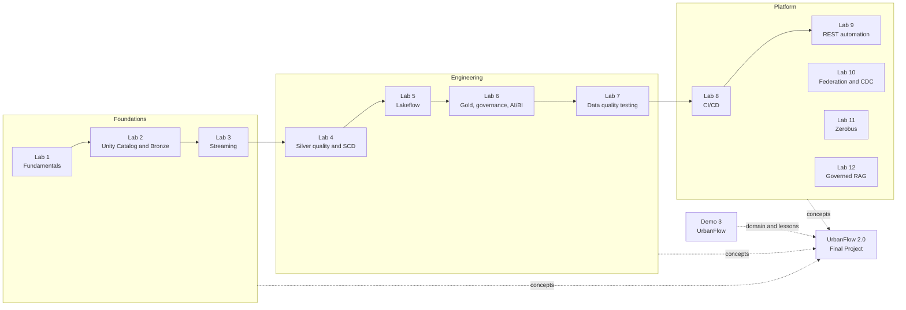

<div align="center">

# Databricks Academy Lakehouse

### End-to-end Data Engineering, Lakehouse Architecture, GenAI and DevOps on Databricks

Twelve hands-on Databricks Academy labs, four demo projects and one integrated capstone, **UrbanFlow 2.0**. It is deployed to two workspaces through gated releases, including a protected GitHub Actions deployment.

[](https://github.com/BadalovP/Databricks-Academy-Lakehouse/actions/workflows/final_project_ci.yml)
[](final_project/README.md)
[](final_project/docs/RELEASE_AND_VALIDATION.md)
[](final_project/evidence/2026-10-13_azure_prod_step9_deploy_and_sample_run.md)
[](https://github.com/BadalovP/Databricks-Academy-Lakehouse/actions/runs/38400575076)
[](https://github.com/BadalovP/Databricks-Academy-Lakehouse/actions/runs/38400575076)

`Python` · `PySpark` · `SQL` · `Delta Lake` · `Unity Catalog` · `Auto Loader` · `Lakeflow` · `Databricks Jobs` · `Asset Bundles` · `GitHub Actions` · `AI Search` · `RAG`

</div>

---

## 🧭 Table of contents

- [Overview](#-overview)
- [Verified status](#-verified-status)
- [Featured project: UrbanFlow 2.0](#-featured-project-urbanflow-20)
- [Technology stack](#-technology-stack)
- [Labs 1–12](#-labs-112)
- [Demo projects](#-demo-projects)
- [From labs to capstone](#-from-labs-to-capstone)
- [Repository structure](#-repository-structure)
- [Getting started](#-getting-started)
- [Verified achievements](#-verified-achievements)
- [Supporting material](#-supporting-material)

---

## 📌 Overview

This repository is my complete Databricks Academy portfolio. Each lab is a self-contained exercise with its own README, code, and evidence such as screenshots or GitHub Actions runs. The topics build up from notebooks and Delta tables to streaming ingestion, data quality, declarative pipelines, CI/CD, REST automation, Lakehouse Federation, push ingestion and governed retrieval-augmented generation.

The capstone, **[UrbanFlow 2.0](final_project/README.md)**, combines those skills in one platform. Citi Bike station and trip data flow through a medallion lakehouse to a rebalancing priority that respects station maintenance. An AI operations assistant answers from cited procedures. Releases are deployed by Asset Bundles through a protected GitHub Actions workflow.

> [!NOTE]
> Work here ran in two kinds of workspace: a **Personal Databricks workspace** (the Final Project's primary development environment) and **Academy Azure Databricks workspaces**. These include the `dbr_dev_trial_2` trial, used as a PROD-style target. It is an Academy trial, not a paid production environment.

---

## ✅ Verified status

| Area | Status | Evidence |
|---|---|---|
| UrbanFlow 2.0 Final Project | ✅ Complete, merged to `main` ([PR #75](https://github.com/BadalovP/Databricks-Academy-Lakehouse/pull/75), follow-ups #76–#78) | [Final Project README](final_project/README.md) |
| Personal DEV validation | ✅ Steps 1–8 passed live: medallion sample, strict idempotency, CDC, Lakeflow, assistant, dashboard, governance | [Release and validation](final_project/docs/RELEASE_AND_VALIDATION.md) |
| Azure trial validation | ✅ Seven resources deployed; sample run `240527908342651` matched DEV on every figure | [Step 9 evidence](final_project/evidence/2026-10-13_azure_prod_step9_deploy_and_sample_run.md) |
| Protected GitHub CD | ✅ Plan, reviewer approval, deploy, drift check and a bounded sample Job passed | [Run 38400575076](https://github.com/BadalovP/Databricks-Academy-Lakehouse/actions/runs/38400575076) · [evidence](final_project/evidence/2026-10-13_github_cd_full_deploy.md) |
| Automated tests (Final Project) | ✅ 867 passed, 1 skipped in the CD run's CI (Linux) | [Run 38400575076](https://github.com/BadalovP/Databricks-Academy-Lakehouse/actions/runs/38400575076) |
| AI assistant | ✅ Evaluated live: correctness 0.685 vs 0.148 baseline (keyword metric), retrieval recall 1.0, refusal decisions 18/18 | [Evaluation evidence](final_project/evidence/2026-10-13_personal_dev_e5_rag_evaluation.md) |
| Labs 1–12 | ✅ Complete; each lab documents its own evidence | [Labs table](#-labs-112) |

---

## ⭐ Featured project: UrbanFlow 2.0

> **Intelligent Urban Mobility Lakehouse & AI Operations Assistant**. Full case study: **[final_project/README.md](final_project/README.md)**.

A bike-share dispatcher needs two answers: **where should the next rebalancing van go, and where must it not go?** When something breaks, they also need the right procedure, quickly. UrbanFlow 2.0 answers both from one governed lakehouse.

| Capability | What it does |
|---|---|
| Medallion pipeline | GBFS station snapshots and Citi Bike trips land in a Unity Catalog Volume, go to Bronze through Auto Loader `availableNow`, are split into Silver, quarantine and duplicates, and become Gold KPIs |
| Transparent prioritisation | Priority = severity + deficit + size points; out-of-service stations are never dispatched to |
| Maintenance CDC | Snapshot → Delta Change Data Feed → audit history → SCD 1 Silver → reconciliation → forward-only checkpoint (safe across `OPTIMIZE`) |
| Lakeflow | A declarative pipeline that reuses the same rule functions, with 22 expectations and row-for-row parity with the notebooks |
| AI/BI dashboard | Five pages over 25 SQL datasets, with `HOLD` notes where a priority meets an open maintenance ticket |
| Operations assistant | Eight fictional procedures, Delta Sync hybrid index, cited answers and clean refusals, measured against a no-retrieval baseline |
| Governance | Row filter and column masks on isolated copies, rolled back afterwards |
| Release engineering | CI (secret scan, Ruff, Black, pytest, bundle schema, docs) and manual CD with a reviewable plan, protected approval, drift check and bounded run |

<details>
<summary><b>Verified headline figures</b></summary>

| Area | Result | Run / evidence |
|---|---|---|
| Station sample | 40 events → Silver 40 → 13 shortages, 13 priorities | DEV `896549012431425`, Azure `240527908342651` |
| History and weather | 40 trips, 48 weather hours, 4 trips with weather | same runs |
| Data quality | 0 quarantined, 0 duplicates; Bronze = Silver + Quarantine + Duplicates | same runs |
| CDC | `batch_002`: 6 change events; `batch_003` replay: no events, checkpoint 3 → 4 over an `OPTIMIZE` version | `343513312512955`, `500336374896739` |
| Lakeflow | 10 datasets, 22 expectations, 0 failures | update `a26b4385` |
| Dashboard | 25 / 25 datasets ran live | [evidence](final_project/evidence/2026-10-13_personal_dev_dashboard_validation.md) |
| Assistant | 36 live chat calls; recall 1.0; citation precision 0.967 | `712590508231976` |
| Full GitHub CD | Deploy plus sample Job `112906299302442` (457 s), business data unchanged | [run 38400575076](https://github.com/BadalovP/Databricks-Academy-Lakehouse/actions/runs/38400575076) |

All data is labelled: real Citi Bike and Open-Meteo samples, fictional maintenance tickets and procedures. The 40-row sample validates logic and integration, not scale.

</details>

---

## 🧰 Technology stack

| Layer | Final Project (UrbanFlow 2.0) | Also used in the labs and demos |
|---|---|---|
| Sources | Citi Bike GBFS and trip archive, Open-Meteo, CSV maintenance snapshots, Markdown procedures | Wikimedia EventStreams, NYC taxi trips, Synthea healthcare, PostgreSQL (Neon) |
| Ingestion | Unity Catalog Volumes, Auto Loader (`availableNow`) | `COPY INTO`, Azure Event Hubs (Kafka), Zerobus Ingest |
| Processing | PySpark, Spark SQL, Delta `MERGE`, Change Data Feed | Structured Streaming with watermarks, SCD Type 2 |
| Pipelines | Lakeflow Spark Declarative Pipelines (serverless, triggered) | Lakeflow streaming tables |
| Storage and governance | Delta Lake, Unity Catalog, row filters, column masks | ADLS Gen2, external locations, Azure Key Vault secret scopes |
| Orchestration | Databricks Jobs (serverless), condition tasks | Job clusters, file-arrival triggers |
| Analytics | AI/BI (Lakeview) dashboards, SQL warehouses | Genie spaces, SQL alerts |
| AI | Databricks AI Search (Delta Sync, hybrid), embeddings, Foundation Model chat | Lab 12 IT-operations RAG |
| Quality and testing | pytest, local Spark, Great Expectations, Lakeflow expectations, reconciliation identities | chispa, Lakehouse monitoring |
| Delivery | Databricks Asset Bundles, GitHub Actions, OAuth M2M, protected environments | Terraform (Lab 08, Lab 10), GitHub OIDC |
| Automation | Databricks SDK, Jobs REST API, SQL Statement Execution API | Lab 09 REST automation |

---

## 📚 Labs 1–12

Each lab is independent. Its README states what was built and how it was validated. The status below summarises that documented evidence.

| # | Lab | Main concepts | Key technology | Status and evidence |
|---|---|---|---|---|
| 1 | [Databricks Fundamentals](labs/lab_01_fundamentals/) | Notebooks, Delta tables, medallion basics, external API, dashboard | PySpark, Unity Catalog Volumes, AI/BI | ✅ Complete: notebook and dashboard committed |
| 2 | [Azure UC Setup & Bronze Ingestion](labs/lab_02_azure_uc_setup/) | Storage, Key Vault, governed landing, Auto Loader vs `COPY INTO` | ADLS Gen2, Key Vault, Asset Bundles | ✅ Complete: two stages, screenshots, bundle deployed and run |
| 3 | [Streaming & Incremental Ingestion](labs/lab_03_streaming_incremental/) | Auto Loader, Event Hubs streaming, watermarks, multi-task Jobs | Event Hubs (Kafka), Structured Streaming | ✅ Complete: screenshots of live runs |
| 4 | [Silver Quality, SCD & Schema Governance](labs/lab_04_silver_quality/) | Quarantine, MERGE, SCD 1/2, schema evolution, Delta maintenance | Delta Lake, pytest | ✅ Complete: 12/12 Job tasks, validation passed |
| 5 | [Lakeflow Declarative Pipelines](labs/lab_05_lakeflow/) | Streaming tables, expectations, Job orchestration | Lakeflow | ✅ Complete: 20/20 validation checks |
| 6 | [Gold Analytics, Governance & AI/BI](labs/lab_06_gold_analytics/) | Star schema, dashboard, Genie, GRANT/RLS/CLS, alerts | AI/BI, Genie, SQL alerts | ✅ Complete: Gold Job and 12 tests ([external variant](labs/lab_06_gold_analytics_external/)) |
| 7 | [Data Quality Testing](labs/lab_07_data_quality_testing/) | Quality score, Great Expectations, pytest, quality gate | Great Expectations, GitHub Actions | ✅ Complete: full run and deploy passed |
| 8 | [CI/CD — TravelOps](labs/lab_08_cicd_travelops/) | DEV → PROD promotion, approvals, Terraform, OIDC and PAT paths | Asset Bundles, Terraform, GitHub OIDC | ✅ Complete: end-to-end CI/CD runs |
| 9 | [REST API Automation](labs/lab_09_rest_api_automation/) | SDK and REST automation, Job creation, reconciliation | Databricks SDK, REST API | ✅ Complete: validated in both workspaces |
| 10 | [Lakehouse Federation & CDC](labs/lab_10_federation_cdc/) | Read-only PostgreSQL federation, incremental Delta sync | Lakehouse Federation, Delta CDF | ✅ Complete: [PR #69](https://github.com/BadalovP/Databricks-Academy-Lakehouse/pull/69), deployed to two environments |
| 11 | [Zerobus Ingest](labs/lab_11_zerobus/) | Push ingestion, durability acknowledgements, idempotent Silver | Zerobus Ingest | ✅ Complete: live in two environments ([#73](https://github.com/BadalovP/Databricks-Academy-Lakehouse/pull/73), [#74](https://github.com/BadalovP/Databricks-Academy-Lakehouse/pull/74)) |
| 12 | [AI Capstone — Governed IT-Operations RAG](labs/lab_12_ai_capstone_rag/) | Governed corpus, vector search, grounded answers, evaluation | AI Search, Foundation Models | ✅ Complete: [PR #70](https://github.com/BadalovP/Databricks-Academy-Lakehouse/pull/70), Personal DEV and Azure |

> [!IMPORTANT]
> The labs are separate implementations. UrbanFlow 2.0 re-implements their ideas inside one project. It does not call lab code or lab resources, and its code refuses Lab 11's tables and credentials.

---

## 🎬 Demo projects

| Demo | Theme | Folder |
|---|---|---|
| Demo 1 | Crypto batch and streaming lakehouse | [Demos/Demo1](Demos/Demo1/) |
| Demo 2 | RetailPulse e-commerce medallion lakehouse | [Demos/Demo2](Demos/Demo2/) |
| Demo 2 (Olist) | Olist e-commerce lakehouse | [Demos/Demo2_Olist](Demos/Demo2_Olist/) |
| Demo 3 | UrbanFlow NYC bike-share operations, the predecessor of the Final Project | [Demos/Demo3](Demos/Demo3/) |

Demo 3's evidence belongs to Demo 3. The Final Project started from its ideas but has its own code, resources and validation.

---

## 🪜 From labs to capstone



*Concept flow, not runtime dependencies: each lab taught a capability that UrbanFlow 2.0 implements itself.*

---

## 📁 Repository structure

```text
Databricks-Academy-Lakehouse/
├── final_project/            # ⭐ UrbanFlow 2.0: the integrated capstone (own bundle, tests, docs, evidence)
├── labs/                     # Labs 1–12, each with its own README, code and evidence
│   ├── lab_01_fundamentals/ … lab_12_ai_capstone_rag/
│   └── lab_06_gold_analytics_external/   # Lab 6 external-storage variant
├── Demos/                    # Demo 1, Demo 2, Demo 2 (Olist), Demo 3 (UrbanFlow predecessor)
├── resources/                # Root Asset Bundle resources for Labs 2–7 (Jobs, pipelines, dashboards, alerts)
├── src/                      # Lab 4 Silver-quality notebooks (root bundle)
├── databricks.yml            # Root Asset Bundle for the labs
├── .github/workflows/        # 14 workflows: Final Project CI/CD, Demo 3, Labs 7–12
├── docs/lab_notes/           # Lab notes
├── architecture/, tests/, tools/   # Supporting folders for the labs
├── requirements.txt
└── QUICK_START.txt           # Lab 6 external-variant quick start
```

`final_project/` is self-contained: its own `databricks.yml`, `pyproject.toml`, tests and documentation.

---

## 🚀 Getting started

**Prerequisites:** Git, Python 3.11, Java 17 (for local Spark tests) and the Databricks CLI. A workspace is only needed for live runs.

```bash
git clone https://github.com/BadalovP/Databricks-Academy-Lakehouse.git
cd Databricks-Academy-Lakehouse
```

| I want to… | Start here |
|---|---|
| Explore the capstone | [final_project/README.md](final_project/README.md) |
| Run the capstone's offline checks | [Reproduce offline](final_project/README.md#22-how-to-reproduce) |
| Understand the release process | [final_project/docs/CI_CD.md](final_project/docs/CI_CD.md) |
| Operate or recover the platform | [final_project/docs/OPERATIONS_RUNBOOK.md](final_project/docs/OPERATIONS_RUNBOOK.md) |
| Run a specific lab | That lab's README in [labs/](labs/) |

Offline checks for the Final Project (no workspace and no credentials):

```bash
cd final_project
python -m venv .venv && . .venv/bin/activate     # Windows: .venv\Scripts\activate
pip install -e ".[dev]"
ruff check . && black --check . && pytest
python scripts/build_dashboard.py --check
python scripts/validate_bundle.py                 # needs the Databricks CLI, no login
python scripts/check_docs.py
```

> [!WARNING]
> Live runs bill serverless compute, and the assistant needs an AI Search endpoint that bills hourly. Follow the approval and cleanup steps in the [operations runbook](final_project/docs/OPERATIONS_RUNBOOK.md) before running anything in a workspace.

---

## 🏆 Verified achievements

- **Two-workspace delivery:** the same bundle was deployed to Personal DEV and to the Azure trial, and both sample runs produced identical, independently verified figures.
- **Protected GitHub CD:** a service principal planned, deployed and ran a bounded Job behind a required reviewer. Temporary deploy rights were removed afterwards ([run 38400575076](https://github.com/BadalovP/Databricks-Academy-Lakehouse/actions/runs/38400575076)).
- **Correct, replay-safe CDC:** insert, update and delete events are audited once, and the checkpoint advances only after reconciliation, including across an automatic `OPTIMIZE`.
- **Measured AI:** a live baseline-versus-RAG evaluation, manually reviewed, with its metric limitations stated.
- **Honest engineering record:** failed runs are kept as evidence next to their fixes ([engineering lessons](final_project/README.md#20-engineering-challenges-and-lessons)).
- **Cost awareness:** about 9.15 DBU (≈ $3 at list price) of Final Project compute in DEV, measured from billing tables. The AI Search endpoint was deleted after 26 minutes.

---

## 📎 Supporting material

| Material | Link |
|---|---|
| Final Project case study | [final_project/README.md](final_project/README.md) |
| Architecture and design decisions | [final_project/docs/ARCHITECTURE.md](final_project/docs/ARCHITECTURE.md) |
| Labs 1–12 coverage by the capstone | [final_project/docs/LABS_1_TO_12_COVERAGE.md](final_project/docs/LABS_1_TO_12_COVERAGE.md) |
| Demo Day talk (25 min) and interview demo (5 min) | [final_project/docs/DEMO_DAY_PRESENTATION.md](final_project/docs/DEMO_DAY_PRESENTATION.md) |
| Final Project workflows | [CI](.github/workflows/final_project_ci.yml) · [CD](.github/workflows/final_project_cd.yml) |

---

**Parvin Badalov**, Data Engineer · [GitHub](https://github.com/BadalovP) · [LinkedIn](https://www.linkedin.com/in/parvin-badalov/)

*Databricks Academy portfolio: from fundamentals to a governed, tested and release-automated lakehouse with an AI assistant. Every result above links to its evidence, and its limits are stated in the Final Project documentation.*
