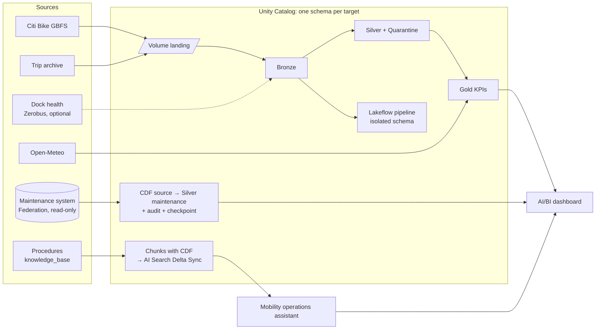
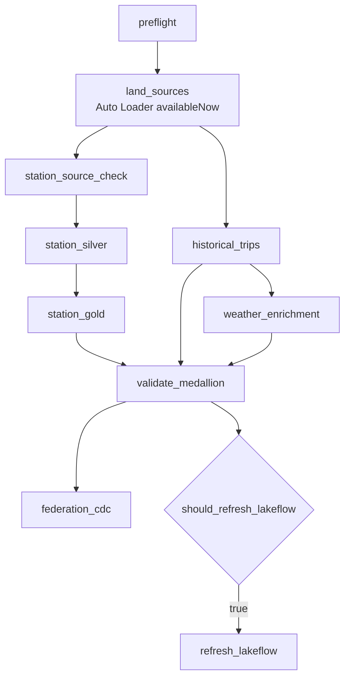
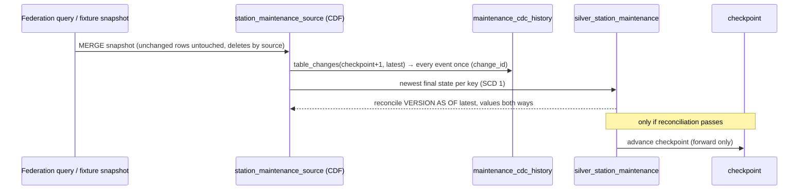
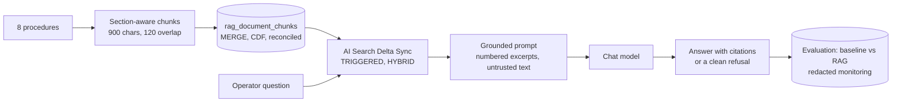
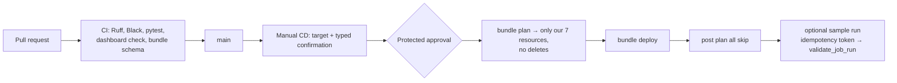

# UrbanFlow 2.0: Intelligent Urban Mobility Lakehouse & AI Operations Assistant

Databricks Academy **Final Project**: one integrated solution that covers Labs 1–12.

> **Status: implemented and tested offline; deployed to Personal DEV (definitions only, 2026-10-12). No Job or pipeline has run yet.**
> More than 700 offline tests (unit tests, local Spark and static checks) run in CI. Every live step needs explicit approval and is planned in [docs/RELEASE_AND_VALIDATION.md](docs/RELEASE_AND_VALIDATION.md). Results of the individual labs and of Demo 3 were produced in their own folders. They are not Final Project evidence and are not presented as such.

| Document | Purpose |
|---|---|
| [Labs 1–12 coverage](docs/LABS_1_TO_12_COVERAGE.md) | Requirement → component → source → tests → live evidence → status |
| [Architecture](docs/ARCHITECTURE.md) | Components, environments, CDC and RAG design, security, failure handling |
| [Cost and performance](docs/COST_AND_PERFORMANCE.md) | Cost drivers with hard bounds, performance decisions, how to measure after a run |
| [Release and validation](docs/RELEASE_AND_VALIDATION.md) | CI, manual CD, identities, the live validation plan and the evidence table |
| [Dashboard](docs/DASHBOARD.md) | Five pages generated per target from read-only SQL |
| [Quality framework](docs/QUALITY_FRAMEWORK.md) | Why Great Expectations, and what it checks |
| [Demo Day presentation](docs/DEMO_DAY_PRESENTATION.md) | 25-minute run of show, slides, demo checklist, expected questions |

## Business problem

An empty station prevents a rental, and a full station prevents a return. Dispatchers need to know **where to send a rebalancing van next, and where not to send one**: a station closed for maintenance cannot be fixed by moving bikes. When something goes wrong, they need **the right procedure, quickly**.

UrbanFlow 2.0 answers both from one governed lakehouse:

- **Station operations:** real Citi Bike GBFS and trip data, plus Open-Meteo weather, flow through Bronze, Silver and Gold to a transparent rebalancing priority. The score is severity + deficit + size, so it can be recomputed by hand.
- **Maintenance awareness:** maintenance tickets arrive through **Lakehouse Federation and Delta Change Data Feed**. The dashboard flags priorities at stations with an open ticket.
- **Operations assistant:** a **RAG assistant** answers from eight UrbanFlow procedures. It cites its sources and refuses when they do not cover the question.

Thresholds (≤ 2 bikes, ≤ 2 docks) are teaching rules, not Citi Bike operating standards.

## Data, honestly labelled

| Data | Source | Label |
|---|---|---|
| Station status and information | [Citi Bike GBFS](https://gbfs.citibikenyc.com/gbfs/2.3/gbfs.json), 40-station dated sample | Real, point-in-time sample; not current operations |
| Trips | [Citi Bike trip history](https://citibikenyc.com/system-data), January 2024, 40-row sample | Real; a **development sample**, not the month |
| Weather | [Open-Meteo archive](https://open-meteo.com/en/docs/historical-weather-api), 48 hours at one NYC coordinate | Real; area-level, not per station |
| Maintenance tickets | [`fixtures/maintenance/`](fixtures/maintenance/README.md), 3 snapshot batches | **Fictional, synthetic** tickets on real sample station IDs |
| Assistant corpus | [`knowledge_base/`](knowledge_base/), 8 procedures | **Fictional** training documents written for this project |
| Station-health telemetry (optional) | Generated by `zerobus.py` | **Synthetic**, flagged `synthetic = true` |

Attribution: [fixtures/samples/ATTRIBUTION.md](fixtures/samples/ATTRIBUTION.md). Historical trips use the GBFS **short name** as `start_station_id`, not the UUID `station_id`. The station dimension keeps both keys.

## 1. Solution architecture



## 2. Platform Job orchestration

Manual and serverless, with no schedule. Every task has a timeout, and every switch defaults to `false`.



The assistant has its own Job: `ingest_knowledge_base → prepare_vector_search → evaluate_rag`. AI Search mutation, live inference and table writes are all off by default.

## 3. Maintenance CDC (Lab 10, core capability)



A failure before the checkpoint replays the same version range, and the MERGEs absorb it. The external system is only read. This is Delta Change Data Feed on a table the project owns, not log-based database CDC.

## 4. Mobility operations assistant (Lab 12)



Offline fixture results (not model quality): retrieval recall 0.938, source coverage 0.875, correctness 0.648, against 0.111 for the no-retrieval baseline. Try it offline:

```bash
urbanflow-rag ask "What should an operator do when both bikes and docks are critically low?"
urbanflow-rag evaluate
```

## 5. CI/CD (Labs 8 and 9)



| Target | Workspace | Schema | Auth in CD |
|---|---|---|---|
| `personal_dev` | Personal Databricks (AWS) | `workspace.urbanflow_final_dev` | OAuth M2M service principal |
| `azure_prod` | Academy Azure `dbr_dev_trial_2` (PROD-style trial) | `dbr_dev.parvinbadalov_urbanflow_final_prod` | GitHub OIDC, no secret |

## Repository layout

| Path | Contents |
|---|---|
| `databricks.yml`, `resources/` | Bundle: two targets; schemas and Volume, two Jobs, Lakeflow pipeline, dashboard |
| `notebooks/` | `01`–`12` platform and optional paths; `20`–`23` assistant. Each code cell has a documented markdown cell. |
| `src/urbanflow/` | Tested library: sources, landing, streaming, Silver, Gold, CDC, Zerobus, automation; `rag/` for the assistant |
| `pipeline/` | Lakeflow declarative Bronze, Silver and Gold with expectations |
| `sql/` | Read-only dashboard SQL (`10`–`14`); governance and maintenance SQL with dangerous statements kept commented (`20`, `21`) |
| `scripts/` | Release validators, dashboard generator, optional Zerobus producer, governance demo (dry run by default) |
| `fixtures/`, `knowledge_base/`, `config/` | Labelled samples, fictional maintenance snapshots, procedures, configuration and evaluation questions |
| `tests/` | More than 700 tests: unit, local Spark, SQL safety, notebook contract, release validators |

## Run locally

```powershell
cd final_project
python -m venv .venv
.\.venv\Scripts\python.exe -m pip install -e ".[dev]"
.\.venv\Scripts\python.exe -m ruff check .
.\.venv\Scripts\python.exe -m black --check .
.\.venv\Scripts\python.exe -m pytest                     # local Spark needs Java 17+
.\.venv\Scripts\python.exe scripts\build_dashboard.py --check
.\.venv\Scripts\python.exe scripts\validate_bundle.py    # needs the Databricks CLI, no login
```

Dry runs that connect to nothing:

```powershell
.\.venv\Scripts\python.exe scripts\run_zerobus_health.py --target personal_dev --run-id local-001
.\.venv\Scripts\python.exe scripts\run_governance_demo.py --target personal_dev
```

## Safety and isolation

- **Own resources only.** The project uses its own schemas, Volume, Jobs, pipeline, dashboard, index and identities. Tests reject Demo 3 schema names in SQL, dashboards and governance code. The Zerobus code refuses Lab 11's schemas, tables and credentials.
- **Serverless only.** Every data task calls `assert_serverless_compute` and refuses classic and shared clusters.
- **Bounded.** No schedules. Streams use `availableNow` with bounded waits. Every task has a timeout, and live call plans are printed before any model call.
- **No secrets in Git.** CD uses OAuth M2M or OIDC. Event Hubs credentials come from a Key Vault-backed secret scope. Monitoring stores question hashes, not questions.
- **Event Hubs path (opt-in).** `station_source=existing_bronze` reads the student's Academy-assigned Event Hub. That hub was also used in earlier coursework, so the consumer filters strictly by execution ID. It needs approval and is not part of the default run.

## Known limitations

- **No live Final Project run yet.** Each live step and its approval is listed in [docs/RELEASE_AND_VALIDATION.md](docs/RELEASE_AND_VALIDATION.md).
- **The `azure_prod` CD identity needs Academy account administration.** An operator can deploy with their own login instead.
- **Small samples.** The data is a 40-station snapshot and a 40-trip sample. The full-month path exists (`run_full_month`), but it is a separate, approved run.
- **Federation and CDC.** Federation needs an approved foreign catalog. Without one, CDC runs on the committed fictional snapshots.
- **Offline assistant figures.** These come from a fixture retriever and an extractive model. Only a live evaluation measures the chat model.
