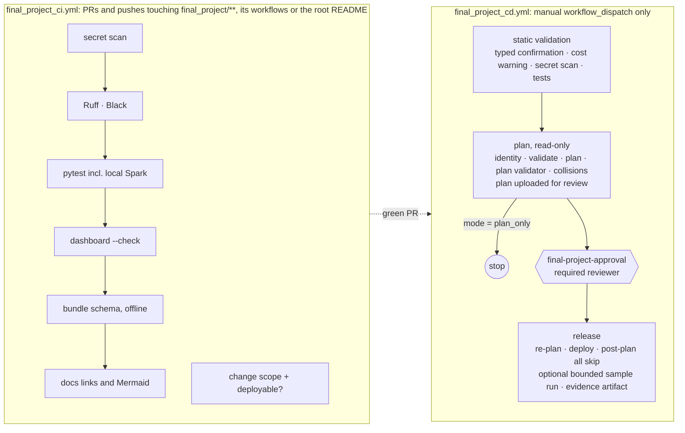

# CI/CD: design, comparison with Lab 08, and the post-merge checklist

[← Final Project README](../README.md#17-cicd) · [Release and validation](RELEASE_AND_VALIDATION.md) · [Operations runbook](OPERATIONS_RUNBOOK.md)

> [!NOTE]
> **Current status (final release, 2026-10-13).** **Complete; full protected GitHub CD live-validated on Personal DEV.** Plan-only run [38392729496](https://github.com/BadalovP/Databricks-Academy-Lakehouse/actions/runs/38392729496) passed (read-only). The full release [38400575076](https://github.com/BadalovP/Databricks-Academy-Lakehouse/actions/runs/38400575076) passed: static validation (867 passed, 1 skipped), service-principal plan 7/7 `skip`, reviewer approval, re-plan, deploy, unchanged post-deploy plan, and one bounded `replay_recorded` sample run (Databricks run `112906299302442`, 457 s) with no business data changed ([evidence](../evidence/2026-10-13_github_cd_full_deploy.md)). The Azure trial was deployed by the operator; **Azure GitHub OIDC is documented but not demonstrated.**
>
> Status terms: **Complete** · **Live-validated** · **Offline-tested** · **Documented but not demonstrated** · **Optional** (defined in the [Final Project README](../README.md)).

The Final Project reuses the engineering principles of the Lab 08 TravelOps pipeline: tests before deployment, bundle validation, gated promotion, protected approvals, OIDC, post-deploy verification and cost warnings. It reuses **none of Lab 08's resources** (workflow, environments, Terraform, state or credentials). It is not a copy of Lab 08's job graph either. The Final Project deploys one Asset Bundle to two targets and needs no Terraform: all of its Databricks objects are bundle-managed, and it creates no Azure infrastructure.

## Pipeline

**Documentation gate.** `scripts/check_docs.py` runs in CI with no network and no extra dependency. It checks the repository homepage, this README, `docs/` and `evidence/`: relative links resolve, `#anchors` match GitHub heading slugs, every Mermaid block starts with a diagram type GitHub renders and its brackets balance, and no image is loaded from an unapproved remote host. Before a documentation release, the Mermaid blocks are also parsed with the official `mermaid` package under Node; that step is local because it needs Node packages.

## Comparison with Lab 08

| # | Capability | Lab 08 TravelOps | Final Project | Notes |
|---|---|---|---|---|
| 1 | Lint, format, unit tests | Ruff, Black, pytest | Ruff, Black, pytest incl. **local Spark** (Java 17) | Equal or stronger |
| 2 | Bundle validation | `bundle validate --strict` with a workspace token | Offline schema validation of every resource file in CI. Authenticated `bundle validate` in the CD plan job | CI needs no secret |
| 3 | DEV/PROD target validation | Both targets validated | Both targets in the offline schema. The CD plan job validates the selected target against the real workspace | — |
| 4 | Detect deployable changes | `detect-changes` job on push | `check_change_scope.py` on PRs reports `deployable=true/false`: docs, evidence and tests alone are not deployable | CD is manual, so a docs-only change is never deployed automatically |
| 5 | Avoid needless deploys | Docs-only pushes skip deployment | No automatic deployment exists. `plan_only` lets an operator see an all-`skip` plan before choosing to deploy | — |
| 6 | Manual dispatch inputs | `azure_auth_mode`, `run_azure_prod_job` | `target`, `mode` (`plan_only` default), `confirm_release` | — |
| 7 | Typed confirmation | — | `RELEASE_URBANFLOW_FINAL_<TARGET>` required | Stronger |
| 8 | Protected environments and reviewers | `personal-prod-approval`, `azure-release-approval` | `final-project-approval` (required reviewer) gates every write, after a reviewable plan | — |
| 9 | Least-privilege auth | PAT (personal), OIDC (Azure) | OAuth M2M service principal (DEV), GitHub OIDC (`azure_prod`). **No PAT** | Stronger |
| 10 | Operator vs. CI identity | Single token | DEV operator releases use the owner's login. CD uses a dedicated service principal | Documented below |
| 11 | Azure OIDC | `azure/login` + Terraform OIDC | Native Databricks GitHub OIDC (workload identity federation) | No Azure secret, no `azure/login` |
| 12 | Safe plan validation | Plan text grep (`0 to add, 0 to change, 0 to delete`) | `validate_release_plan.py` on the JSON plan: only the 7 reviewed resources, no delete, target-prefixed names, no cluster, schedule or trigger, no Job name collision | Stronger: structured, tested |
| 13 | No unreviewed creates/updates/deletes | Terraform state checks, RBAC no-op check | Plan validator before the approval **and** again right before deploy | — |
| 14 | Post-deploy drift check | Plan must show 0 changes | Post-deploy plan must be all `skip` | Equal |
| 15 | Optional bounded Job run | `bundle run` (unbounded) | `deploy_and_sample_run`: idempotency token, 40-minute bound, cancel on overrun | Stronger |
| 16 | Machine-readable result check | — | `validate_job_run.py` reads the run JSON and the final validation output | Stronger |
| 17 | Failure reporting and artifacts | Terraform plan artifacts | Plan and release evidence uploaded with `if: always()`, and plan/post-plan/run verdicts in the run summary | — |
| 18 | Deployment evidence | Logs | Artifact with pre/post plans, validator verdicts, run JSON and validation | — |
| 19 | Cost warnings | Manual-dispatch warning | Warning per mode and target (deploy, sample run, shared catalog) | Equal |
| 20 | Concurrency and safe cancellation | One group per ref, no cancel | One group per target, no cancel-in-progress, job timeouts. A cancelled release cancels its Databricks run | Stronger |
| 21 | DEV/PROD isolation | Separate targets and environments | Separate targets, environments and pinned hosts, plus refused shared Academy hosts | — |
| 22 | Secret scanning | — | `scan_secrets.py` in CI and in CD static validation, plus the evidence marker test | New |
| 23 | Rollback and recovery guidance | Runbook | [Runbook](OPERATIONS_RUNBOOK.md): redeploy the previous commit through the same gates; never `bundle destroy` (storage is `prevent_destroy`) | — |
| 24 | No unintended auto-run | Push to `main` deploys DEV automatically | CD never runs on push or PR | Stricter by design |
| — | Terraform plan/apply | Yes (Azure storage, access connector, RBAC) | **Not used** | The Final Project creates no Azure infrastructure, so Terraform would add state and permissions without a resource to manage. Lab 08's Terraform is untouched. |
| — | Personal PROD target | Yes | **No** | The PROD-style target is `azure_prod`, separate cloud and metastore. A second personal target would duplicate DEV. |

**Lessons carried over from Lab 08:**
- **A skipped job must never silently skip its dependants.** Every `needs`/`if` pair is a plain AND chain with no `always()` or OR branch, and a test enforces this.
- **Pin the authentication host,** so bundle-context auto-detection cannot authenticate against the wrong workspace.
- **Validate before an approval is requested,** so the reviewer approves a known plan.

## What is validated, and what is not

| Item | Status |
|---|---|
| CI on PR #75 | Final checks green; PR merged to `main` as `225545fd1f54607d23996c58daee7ef7e1c924fd` |
| Workflow structure | Tested offline: triggers, inputs, job graph, environments, permissions, timeouts, no bypass conditions, `bash -n` on every `run:` block |
| Release gates (plan validator, post-plan check) | Exercised live by the operator releases on `personal_dev` (steps 1, 4A, 4C, D, title fix) and on `azure_prod` (step 9: 7 creates, then post-plan all `skip`), with the same scripts the CD calls |
| CD `plan_only` | **Live-validated.** Run [38392729496](https://github.com/BadalovP/Databricks-Academy-Lakehouse/actions/runs/38392729496) on `e497841`: service-principal sign-in, 7/7 `skip`, validator PASS, approval and release skipped, zero writes. Two earlier dispatches failed on a missing `-t` flag and are kept as evidence |
| CD `deploy_and_sample_run` (Personal DEV) | **Live-validated.** Run [38400575076](https://github.com/BadalovP/Databricks-Academy-Lakehouse/actions/runs/38400575076) on `0d48970`: approval 12:55:46 UTC, deploy, post-plan 7/7 `skip`, sample run `112906299302442` SUCCESS with `replay_recorded`, business data unchanged. The earlier attempt [38397086064](https://github.com/BadalovP/Databricks-Academy-Lakehouse/actions/runs/38397086064) failed on the deployment lock with nothing written ([evidence](../evidence/2026-10-13_github_cd_full_deploy.md)) |
| CD to `azure_prod` (GitHub OIDC) | **Documented but not demonstrated:** the OIDC service principal needs Academy account administration. Azure was deployed by the operator (step 9) |

## Required GitHub configuration (configured on 2026-10-13)

| Environment | Protection | Variables / secrets |
|---|---|---|
| `final-project-approval` | Required reviewer: the project owner. No secrets. | — |
| `final-project-personal_dev` | Deployment branches: `main` only. **No** required reviewer, so the read-only plan job can run before approval. | Variables `DATABRICKS_CLIENT_ID`, `DATABRICKS_WAREHOUSE_ID` (`410e5f3b4784e981`). Secret `DATABRICKS_CLIENT_SECRET` |
| `final-project-azure_prod` | Deployment branches: `main` only. No required reviewer. | Variables `DATABRICKS_CLIENT_ID`, `DATABRICKS_WAREHOUSE_ID` (`d8b8ff9942968cb8`). No secret |

### Identities

**`personal_dev`: OAuth M2M service principal.** It is owned by the project owner and does not need the Academy.
1. Create a service principal, for example `sp-urbanflow-final-dev`, in the personal workspace (Settings → Identity and access).
2. Grant it:
   - `USE CATALOG` on `workspace`;
   - `USE SCHEMA`, `CREATE TABLE` and `CREATE VOLUME`, or ownership, on the two Final Project schemas;
   - `CAN USE` on the Starter warehouse;
   - `CAN MANAGE` on the two Jobs, the pipeline and the dashboard.

   Alternatively, transfer ownership of the bundle resources to it. The first CD deploy as a new identity re-owns the bundle's state folder, so run `plan_only` first.
3. Create an OAuth secret for it. Store the client ID as the environment variable and the secret as the environment secret. Never commit or print either.

**`azure_prod`: Databricks GitHub OIDC.** This needs Academy account-admin rights.
1. Create a service principal in the Databricks account of `dbr_dev_trial_2`.
2. Create a federation policy for it with:
   - issuer `https://token.actions.githubusercontent.com`;
   - audience: the Databricks account ID;
   - subject `repo:BadalovP/Databricks-Academy-Lakehouse:environment:final-project-azure_prod`.
3. Grant the same object privileges, scoped to `dbr_dev.parvinbadalov_urbanflow_final_*`.

**As implemented for `personal_dev`:** the principal holds only read grants by default, which is enough for `plan_only`. For the approved release it temporarily received `CAN_MANAGE` on the bundle folder alone (the CLI must create `deploy.lock`; `CAN_EDIT` cannot) and `CAN_MANAGE_RUN` on the platform Job. Both were removed after run 38400575076, restoring `CAN_READ` on the folder and `CAN_VIEW` on the Job. The OAuth secret expires on 2026-10-14 at 10:22 UTC.

The Final Project does not create either identity without the owner's explicit request, and it does not contact the Academy administrators.

## Post-merge closeout (2026-10-13): identity and state isolation

| Item | State |
|---|---|
| GitHub environments | `final-project-approval`: required reviewer `BadalovP`, admin bypass off. `final-project-personal_dev`: `main` only; variables `DATABRICKS_CLIENT_ID`, `DATABRICKS_WAREHOUSE_ID`; encrypted secret `DATABRICKS_CLIENT_SECRET`. `final-project-azure_prod`: `main` only; `DATABRICKS_WAREHOUSE_ID`; **no identity credential** |
| DEV identity | Service principal `sp-urbanflow-final-dev`, entitlements `workspace-access` and `databricks-sql-access`, no group, no admin role, no ownership, no `CAN_MANAGE` |
| DEV grants (read-only) | `CAN_VIEW` on both Jobs, the pipeline and the warehouse. `CAN_READ` on the dashboard and on the bundle state folder `/Workspace/Users/parvinbadalov@yahoo.com/.bundle/urbanflow_final_project/personal_dev`. `USE CATALOG` on `workspace`, `USE SCHEMA` on the two Final Project schemas, `READ VOLUME` on the Final Project Volume |
| State isolation | Both targets' `workspace.root_path` used `${workspace.current_user.userName}`, so a service principal would read an empty state folder and plan seven creates. Both are now **pinned to the existing deployment folders**. The owner plans stayed all `skip` on both targets after the change (read-only check), and a test guards the pin |
| What `bundle plan` touches | Verified with `--debug`: only GET requests (state files, warehouses, dashboard and its published version, pipeline, two schemas, Volume, two Jobs); **no lock and no write**. The principal's read-only grants make a write impossible |
| First dispatch | Run `38382998636` (on `225545f`): static validation passed. The plan job **failed** at `databricks current-user me` with `please specify target`, before any Databricks call. Fix: `-t "$TARGET"` on both identity checks ([evidence](../evidence/2026-10-13_github_cd_plan_only_closeout.md)) |
| Corrected dispatch | Run [38389951946](https://github.com/BadalovP/Databricks-Academy-Lakehouse/actions/runs/38389951946) on `34b458b`. **Authenticated as `sp-urbanflow-final-dev`**; `bundle validate` and `bundle plan` passed. The uploaded plan is **7/7 `skip`** with no field change, so the principal recognised the existing deployment. The run then **failed** at `databricks jobs list` (same missing `-t`); the release validator passed offline on the uploaded plan. All workspace commands now pass `-t "$TARGET"`, with a test. Not re-dispatched ([evidence](../evidence/2026-10-13_github_cd_plan_only_run2.md)) |
| Plan-only PASS | Run [38392729496](https://github.com/BadalovP/Databricks-Academy-Lakehouse/actions/runs/38392729496) on `e497841`: 860 passed, 1 skipped; SP plan 7/7 `skip`; validator PASS inside the workflow; zero writes |
| Deploy attempt | Run [38397086064](https://github.com/BadalovP/Databricks-Academy-Lakehouse/actions/runs/38397086064) on `0d48970`: approval granted, then `Failed to acquire deployment lock: access denied` with folder `CAN_EDIT`. Nothing written, no Job run |
| Full protected CD PASS | Run [38400575076](https://github.com/BadalovP/Databricks-Academy-Lakehouse/actions/runs/38400575076) on `0d48970` after an owner-approved temporary `CAN_MANAGE` on the bundle folder; sample run `112906299302442`; least privilege restored afterwards ([evidence](../evidence/2026-10-13_github_cd_full_deploy.md)) |
| Azure OIDC | **Blocked by identity setup:** no Final Project service principal or GitHub federation policy exists in the Academy account. Nothing was created there |

### Sample-run profile (`sample_profile` input)

The platform Job's defaults describe a first run on an empty target: a new station execution and CDC snapshot `batch_001`. On Personal DEV, which is at `batch_003`, that would revert the maintenance state and add a second station execution. So `deploy_and_sample_run` builds its request with `scripts/cd_sample_request.py` (tested):

| Profile | Parameters | Use |
|---|---|---|
| `replay_recorded` (default) | The target's recorded executions. DEV: station `urbanflow-final-304828008837365`, CDC `batch_003`. Azure trial: station `urbanflow-final-240527908342651`, CDC `batch_001` | Idempotent replay of existing data, the configuration step 3 proved writes no business data |
| `first_run` | The Job defaults: new station execution, CDC `batch_001` | Only a target with no Final Project data |

## Can a CD demonstration happen without any Azure identity?

**Yes, for `personal_dev`, and it was demonstrated on 2026-10-13** ([evidence](../evidence/2026-10-13_github_cd_full_deploy.md)). A Personal DEV release needs only:
1. PR #75 merged (complete: `225545f`, satisfying the default-branch rule for `workflow_dispatch`);
2. the environments `final-project-approval` and `final-project-personal_dev`;
3. the DEV OAuth M2M service principal, which the project owner can create in the personal workspace without the Academy.

`plan_only` against `personal_dev` is read-only and writes nothing, so it is the safest first run. The `azure_prod` path stays unavailable until the OIDC identity exists. Its plan job fails at authentication, before any write.

**Remaining admin dependencies:**

| Dependency | Who | Needed for |
|---|---|---|
| DEV service principal + OAuth secret | Project owner (workspace admin of the personal workspace) | Any CD run against `personal_dev` |
| `azure_prod` service principal + GitHub federation policy | Academy account admin of `dbr_dev_trial_2` | Any CD run against `azure_prod` |
| Grants in shared `dbr_dev` for that principal | Academy catalog owner | `azure_prod` deploy as the principal |
| GitHub environments and required reviewer | Repository owner | Any CD run |

Until then, operator releases with the owner's own login use the same plan gates. They are recorded for every DEV deploy in `RELEASE_AND_VALIDATION.md`.

## Post-merge demonstration checklist

**Outcome (2026-10-13):** step 2 passed (run 38392729496). Step 4 passed and includes the deploy of step 3 (run 38400575076). Step 1, step 5's negative checks and step 6 were not run as separate dispatches; step 6 stays blocked by the Azure OIDC identity. The results are recorded in `RELEASE_AND_VALIDATION.md`.

Run only after the configuration above exists and bundle-state isolation has been reviewed. Each dispatch is a separate, approved action.

1. Push a docs-only change on a branch, open a PR, and confirm in CI that `change-scope` reports `deployable=false`. Close the PR.
2. Dispatch `target=personal_dev, mode=plan_only`. Expect:
   - static validation green;
   - the plan job prints the service principal identity, 7 `skip` actions and validator `PASS`;
   - the plan artifact is uploaded;
   - approval and release are skipped.
3. Dispatch `target=personal_dev, mode=deploy`. Expect the approval prompt. After approval: re-plan, deploy, post-plan all `skip`, evidence artifact.
4. Optional (bills about 1.3 DBU): `mode=deploy_and_sample_run`. Expect one run and `validate_job_run.py` PASS.
5. Negative checks:
   - a wrong `confirm_release` fails in static validation;
   - cancelling during a sample run cancels the Databricks run (check the Jobs UI).
6. `azure_prod` only after the OIDC identity exists and a PROD deployment is approved: `plan_only` first, then `deploy`.
7. Record the run URLs and artifacts in `RELEASE_AND_VALIDATION.md`.
