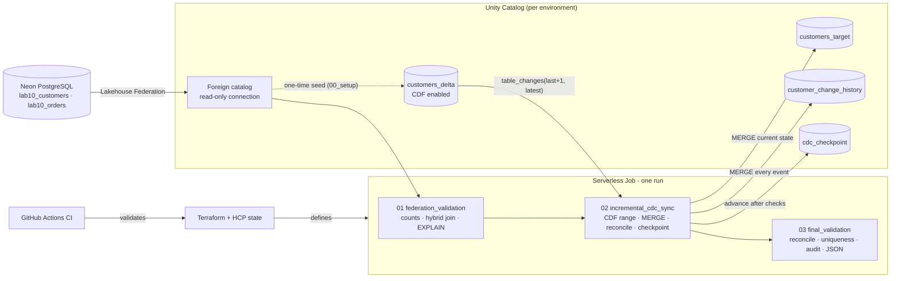

# Lab 10 · Lakehouse Federation & CDC

**Neon PostgreSQL federation · Delta Change Data Feed · checkpointed incremental MERGE · Terraform on HCP · GitHub Actions CI/CD**

> **Status (2026-10-12): complete, merged and deployed in two environments.** Released to `main` via [PR #69](https://github.com/BadalovP/Databricks-Academy-Lakehouse/pull/69) (commit `ed35fb4`, CI green). Personal DEV Job `453391098761164` covers the full CDC scenario. Azure Job `582983448494007` in the Academy workspace `dbr_dev_trial_2` passed its end-to-end run `499124610685736` (3/3 tasks, final validation PASS). Both Terraform states show no drift. Evidence is in [`evidence/`](evidence/).

## Overview and objectives

The lab connects a live PostgreSQL database to the lakehouse without copying it, then keeps a Delta table in sync incrementally:

1. **Federation:** query Neon PostgreSQL in place through Unity Catalog, and join remote rows with local Delta data.
2. **Incremental CDC:** read only new commits from a Delta table's Change Data Feed, and apply inserts, updates and deletes with `MERGE`.
3. **Correctness:** keep an audit history of every change event, reconcile source and target, advance a checkpoint only after the checks pass, and make every rerun safe.
4. **Operations:** deploy the same notebooks as a serverless Job with Terraform, remote HCP state and GitHub Actions CI.

> [!NOTE]
> **Two integration patterns, deliberately.** Neon is reached through Lakehouse Federation (live, read-only queries). CDC runs on a local Delta table with Change Data Feed. The lab does not capture changes from PostgreSQL itself (no logical replication, WAL decoding or Debezium), so it is not PostgreSQL-native CDC.

## Technology stack

| Layer | Technology |
|---|---|
| External source | Neon serverless PostgreSQL (`lab10_customers`, `lab10_orders`) |
| Federation | Unity Catalog connection (`read_only`) and foreign catalog |
| Storage and CDC | Delta Lake, Change Data Feed, `table_changes`, `MERGE`, time travel |
| Compute | Databricks serverless Jobs compute; Serverless SQL warehouse for ad-hoc checks |
| Orchestration | One Databricks Job, three Git-sourced notebook tasks |
| Infrastructure as code | Terraform `databricks/databricks` 1.137.0, state in HCP Terraform |
| CI/CD | GitHub Actions; static validator and tests in Python (standard library only) |

## Architecture and data flow



| Task | Notebook | Writes |
|---|---|---|
| 1 | [`01_federation_validation`](01_federation_validation.ipynb) - federated counts, PostgreSQL-to-Delta `LEFT JOIN`, `EXPLAIN EXTENDED` | Nothing |
| 2 | [`02_incremental_cdc_sync`](02_incremental_cdc_sync.ipynb) - CDF range read, target and history `MERGE`, reconciliation, checkpoint | Own schema only |
| 3 | [`03_final_validation`](03_final_validation.ipynb) - reconciliation at the checkpoint, uniqueness, audit completeness; returns a JSON summary | Nothing |

[`00_setup`](00_setup.ipynb) is not a Job task. It runs once per new environment: it creates the schema and four tables, enables CDF on the source, seeds the source from Neon through the foreign catalog and sets the checkpoint to version 0. It never drops, truncates or reseeds, and it stops on an inconsistent state instead of guessing.

## Lakehouse Federation with Neon PostgreSQL

A Unity Catalog **connection** stores the Neon endpoint and credentials; a **foreign catalog** exposes the PostgreSQL tables as `<catalog>.public.<table>`. Rows stay in PostgreSQL, and Databricks pushes supported work down to it. In the Azure plan for `lab10_orders WHERE amount > 100`, the scan is `Scan JDBC` with the filter in `PushedDownOperators`.

Notebook 01 proves:

- direct federated reads: 12 customers and 20 orders;
- a hybrid query, Neon orders `LEFT JOIN` Delta customers, that keeps every order exactly once;
- the query plans of a federated and a local Delta query, side by side.

The connection is `read_only`, so the lab never writes to Neon. In Azure the foreign catalog is bound read-only to the one workspace that runs the Job and is set to `ISOLATED`, so other workspaces on the shared metastore cannot use it.

## Delta Change Data Feed and incremental CDC

`customers_delta` has `delta.enableChangeDataFeed = true` from its creation, so every commit is captured. Each run of notebook 02:

1. Reads `last_processed_version` from `cdc_checkpoint` and the source's latest version from `DESCRIBE HISTORY`.
2. If they are equal, prints `NO NEW CHANGES` and writes nothing.
3. Otherwise reads `table_changes(source, last + 1, latest)`, exactly the new range, and refuses null keys and duplicate `(customer_id, _commit_version, _change_type)` events.
4. Keeps the newest final-state event per customer (`insert`, `update_postimage` or `delete`) and `MERGE`s it into `customers_target` (SCD Type 1; a delete removes the row; unchanged rows are not rewritten).
5. `MERGE`s every event, including `update_preimage`, into `customer_change_history`, keyed by `(customer_id, _commit_version, _change_type)`.

## MERGE, checkpoints, reconciliation and idempotency

| Guarantee | How it is enforced |
|---|---|
| Correct target state | Target is compared with the source **at the processed version** (time travel) with `EXCEPT ALL` in both directions; both counts must be 0 |
| Complete audit | Every event read in the run must be present in history; notebook 03 also compares all of history with `table_changes` in both directions |
| No duplicates | Unique `customer_id` in source and target; unique event key in history |
| Safe checkpoint | The checkpoint `MERGE` runs **after** all assertions; a failure leaves it unchanged. The static validator fails CI if this order is reversed |
| Idempotent reruns | With no new versions the run writes nothing. A replayed range is harmless because both writes are `MERGE`s that skip existing rows |
| No silent repeats | Serverless auto-retry is disabled on every Azure task (`disable_auto_optimization = true`), so a failed run is inspected, not repeated |

## Environments and deployment

All notebooks take `catalog` and `schema` parameters (00 and 01 also take `foreign_catalog`). Their defaults are the Personal DEV names, so the DEV Job passes no parameters, while the Azure Job passes its own.

| | Personal DEV | Azure (PROD-style) |
|---|---|---|
| Workspace | Personal `dbc-1750318a-76a9.cloud.databricks.com` | Academy `dbr_dev_trial_2` (`adb-7405618361895520.0.azuredatabricks.net`) |
| Delta schema | `workspace.lab_10_federation_cdc` | `dbr_dev.parvinbadalov_lab10_prod` (shared Academy metastore) |
| Foreign catalog / connection | `neon_postgres_conn_catalog` / `neon_postgres_conn` | `parvinbadalov_lab10_neon_catalog` / `parvinbadalov_lab10_neon_conn` |
| Job | [`453391098761164`](https://dbc-1750318a-76a9.cloud.databricks.com/#job/453391098761164) | [`582983448494007`](https://adb-7405618361895520.0.azuredatabricks.net/#job/582983448494007) |
| Compute | Serverless | Serverless; no cluster, schedule or trigger; one concurrent run; 30-minute timeout |
| Notebook source | GitHub `main` | GitHub `main` |
| Terraform root / HCP workspace | [`terraform/`](terraform/) / `lab10-personal-dev` | [`terraform_azure_prod/`](terraform_azure_prod/) / `lab10-azure-prod` |
| Deployed by | GitHub Actions CD (manual, plan or apply) | Terraform with the owner's Azure CLI identity (reviewed saved plan) |

"Azure PROD" means a production-style deployment - separate state, reviewed saved plans, serverless compute, no manual Job edits - into a shared training workspace, not a production system.

## Terraform and GitHub Actions CI/CD

**State separation.** Each environment has its own Terraform root, HCP workspace (local execution), resource and pinned provider host. A change in one can never read, refresh or destroy the other's state, and no Azure Storage account is used for state. Neither Job declares `existing_cluster_id`, `new_cluster` or `job_cluster`.

| HCP workspace | Resource | Latest result |
|---|---|---|
| `lab10-personal-dev` | `databricks_job.lab10` (`453391098761164`) | plan `No changes` |
| `lab10-azure-prod` | `databricks_job.lab10_azure_prod` (`582983448494007`) | created with `1 to add`; re-pointed to `main` with one in-place change (`git_source.branch`); plan `No changes`; state serial 2 |

**CI** - [`lab10_terraform_ci.yml`](../../.github/workflows/lab10_terraform_ci.yml) runs on every Lab 10 pull request and push to `main`. It contacts no workspace and checks:

- [`scripts/validate_lab10_static.py`](scripts/validate_lab10_static.py) compiles every notebook cell, enforces the CDC contract (delete handling, two-way reconciliation, checkpoint last), non-destructive setup, serverless-only Jobs with auto-retry off, pinned workspace hosts, workflow safety and secret patterns;
- [23 tests](tests/test_validate_lab10_static.py) prove the validator rejects each unsafe change;
- `terraform fmt -check`, `init -backend=false` and `validate` on both roots.

### CD

- **Personal DEV:** [`lab10_terraform_cd.yml`](../../.github/workflows/lab10_terraform_cd.yml) is manual. An empty confirmation runs a plan; `APPLY-453391098761164` applies.
- **Azure (optional automation):**
  - [`lab10_azure_prod_cd.yml`](../../.github/workflows/lab10_azure_prod_cd.yml) and [`lab10_azure_prod_run.yml`](../../.github/workflows/lab10_azure_prod_run.yml) use native Databricks GitHub OIDC (no PAT or cloud secret).
  - They require `main` and a confirmation phrase, use saved-plan apply, refuse the other Academy workspace hosts, cluster compute or duplicate Jobs, and pin action SHAs.
  - They target the same HCP state as the manual deployment.
  - They need a dedicated service principal that only an account administrator can create ([ADMIN_REQUEST.md](ADMIN_REQUEST.md)), so they have not run yet.

## Testing and verified results

| Check | Personal DEV | Azure |
|---|---|---|
| Federated customers / orders | 12 / 20 | 12 / 20 |
| Hybrid join: orders kept / without a Delta customer | 20 / 3 (after simulated deletes) | 20 / 0 |
| Source / target / history rows | 12 / 12 / 12 | 12 / 12 / 12 |
| Source-target differences, both directions | 0 / 0 | 0 / 0 |
| History vs CDF, both directions | 0 / 0 (versions 3-10) | 0 / 0 (version 1) |
| Duplicate keys (target, history) | 0, 0 | 0, 0 |
| Checkpoint = latest source version | 10 | 1 |
| CDF events covered | insert ×2, update pre/post-image ×4 each, delete ×2 | insert ×12 (the seed batch) |
| No-change rerun | run `1058102967727375`: 0 events, nothing written | not repeated |
| Job runs | `1058102967727375`, `674533552504139` SUCCESS | [`499124610685736`](https://adb-7405618361895520.0.azuredatabricks.net/#job/582983448494007/run/499124610685736) SUCCESS, 3/3 tasks, attempt 0 |
| CI / CD | CI green; CD plan run `38102000753`, apply run `38102681544` (0 changes) | CI green on `main` (run `38215896847`); OIDC CD not run |

**Coverage difference.** Personal DEV exercised the full scenario: inserts, updates, deletes and a no-change rerun. Azure ran the same notebooks once on new infrastructure. That run proved federation, the hybrid join, CDF reading, both `MERGE`s, reconciliation, query-plan pushdown and the late checkpoint, all with real CDF events. Updates, deletes and the no-change rerun were not repeated in Azure: that would have needed artificial source changes and more billed runs, without testing new logic.

The Azure run's final validation output:

```json
{"status": "PASS", "schema": "dbr_dev.parvinbadalov_lab10_prod", "source_rows": 12, "target_rows": 12,
 "history_events": 12, "processed_version": 1, "latest_source_version": 1,
 "source_target_differences": 0, "history_duplicates": 0}
```

### Evidence

- [Release](evidence/2026-10-12-release.md): merge, re-point to `main`, final read-only verification of both environments.
- [Azure deployment and end-to-end run](evidence/2026-10-12-manual-azure-deployment.md): catalog binding, setup run `326755590926905`, Terraform apply, the Job run, independent SQL checks, Personal DEV re-verification.
- [Deployment readiness](evidence/2026-10-12-manual-deployment-readiness.md), [approved setup](evidence/2026-10-12-approved-setup.md), [validation and OIDC review](evidence/2026-10-12-validation-and-oidc-review.md), [read-only audit](evidence/2026-10-12-read-only-audit.md).

## How to run or reproduce

**Offline checks** (no workspace needed):

```powershell
cd labs/lab_10_federation_cdc
python scripts/validate_lab10_static.py
python -m unittest discover -s tests -v
terraform -chdir=terraform_azure_prod fmt -check
terraform -chdir=terraform_azure_prod init -backend=false
terraform -chdir=terraform_azure_prod validate
```

**New environment:**

1. Create a `read_only` PostgreSQL connection to Neon and a foreign catalog on it containing `public.lab10_customers` and `public.lab10_orders`. Creating a catalog needs metastore privileges.
2. Run `00_setup` once with `catalog`, `schema` and `foreign_catalog`. Expect four tables, 12 seeded customers and checkpoint 0.
3. Deploy the Job with Terraform (Azure example; authentication uses `az login`, no PAT):

   ```powershell
   cd labs/lab_10_federation_cdc/terraform_azure_prod
   $env:DATABRICKS_AUTH_TYPE = "azure-cli"
   terraform init
   terraform plan -out lab10.tfplan      # review: one Job, serverless, no destroy
   terraform apply lab10.tfplan
   ```

   The run-as user needs GitHub linked in the workspace (Settings → Linked accounts), because the tasks are Git-sourced.
4. Run the Job once. The first run processes the seed as a batch of inserts.
5. To demonstrate updates and deletes, change rows in the **Delta source** `customers_delta` (never in Neon), then run the Job again. A further run without changes must report `NO NEW CHANGES`.

**Inspect the result** in SQL:

```sql
SELECT (SELECT count(*) FROM dbr_dev.parvinbadalov_lab10_prod.customers_delta)        AS source_rows,
       (SELECT count(*) FROM dbr_dev.parvinbadalov_lab10_prod.customers_target)       AS target_rows,
       (SELECT count(*) FROM dbr_dev.parvinbadalov_lab10_prod.customer_change_history) AS history_events,
       (SELECT last_processed_version FROM dbr_dev.parvinbadalov_lab10_prod.cdc_checkpoint) AS checkpoint;

SELECT * FROM dbr_dev.parvinbadalov_lab10_prod.customers_delta          -- expect no rows
EXCEPT ALL SELECT * FROM dbr_dev.parvinbadalov_lab10_prod.customers_target;
```

## Repository map

```text
lab_10_federation_cdc/
|-- 00_setup.ipynb                   # one-time, idempotent environment setup
|-- 01_federation_validation.ipynb   # Job task 1
|-- 02_incremental_cdc_sync.ipynb    # Job task 2
|-- 03_final_validation.ipynb        # Job task 3
|-- terraform/                       # Personal DEV Job (HCP lab10-personal-dev)
|-- terraform_azure_prod/            # Azure Job (HCP lab10-azure-prod)
|-- scripts/validate_lab10_static.py # offline contract, safety and secret checks
|-- tests/                           # tests proving the validator rejects unsafe changes
|-- evidence/                        # sanitized records of live verification
`-- ADMIN_REQUEST.md                 # setup for the optional GitHub OIDC deployment identity
```

## Limitations and future improvements

### Limitations

- CDC is simulated on Delta with CDF; PostgreSQL changes are visible through Federation but not captured as change events.
- Small scale: 12 customers prove correctness and replay safety, not throughput.
- The Azure workspace `dbr_dev_trial_2` is a trial created on 2026-10-06 and may expire around 2026-10-20. The Job lives in that workspace; the Delta tables (shared `dbr_dev` catalog), code, evidence and HCP state do not depend on it.
- In the shared `dbr_dev` catalog, `account users` hold `ALL_PRIVILEGES`, so the Lab 10 schema is isolated by naming, not by grants. That is an Academy setting outside this lab.
- Notebooks are committed without outputs; results come from Job runs and the evidence files.

### Optional future improvements

- Enable the automated Azure deployment: an account administrator creates the GitHub OIDC service principal and federation policy ([ADMIN_REQUEST.md](ADMIN_REQUEST.md)).
- Capture changes from PostgreSQL itself, for example with logical replication into a Delta bronze table, instead of simulating CDC on Delta.
- Add a CDF retention check, so a checkpoint older than the retained history fails clearly instead of reading an incomplete range.
- Redeploy the Azure Job to a permanent workspace before the trial expires, if it should stay live.
