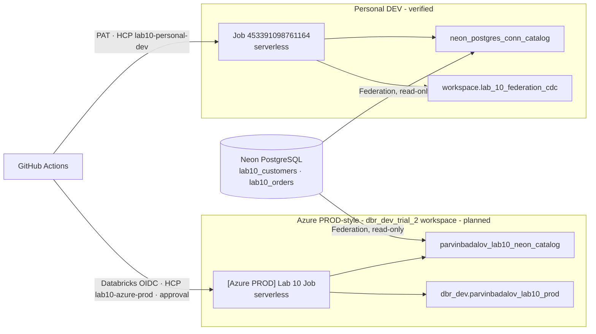

# Lab 10 · Lakehouse Federation & CDC

**Neon PostgreSQL federation · Delta Change Data Feed · checkpointed incremental MERGE · Terraform on HCP · GitHub Actions CI/CD**

> [!IMPORTANT]
> **Personal DEV is complete and verified.** **Azure PROD is prepared but NOT deployed**: no Azure Lab 10 Job, schema, table, foreign catalog, HCP state workspace, or GitHub OIDC deployment identity exists yet.
>
> "Azure PROD" is a **PROD-style deployment into the Academy workspace `dbr_dev_trial_2`** - a shared training workspace, not a production environment. It is called PROD because it is deployed and promoted like one: separate state, approval gates, native Databricks OIDC and no manual changes. Nothing below marked *planned* has run.

> [!NOTE]
> **Two integration patterns, deliberately.** Neon PostgreSQL is reached **through Lakehouse Federation** - live, read-only queries. **CDC is simulated on a local Delta table** with **Delta Change Data Feed**. This lab does not capture changes from PostgreSQL itself (no logical replication, WAL decoding or Debezium), so it is not PostgreSQL-native CDC.

## Status at a glance

| Area | Personal DEV | Azure PROD |
|---|---|---|
| Workspace | Personal `dbc-1750318a-76a9.cloud.databricks.com` | Academy **`dbr_dev_trial_2`** `adb-7405618361895520.0.azuredatabricks.net` |
| Unity Catalog | Personal metastore | Shared Academy metastore `metastore_azure_eastus`; data in the shared `dbr_dev` catalog |
| Delta schema | `workspace.lab_10_federation_cdc` | `dbr_dev.parvinbadalov_lab10_prod` (*planned*) |
| Foreign catalog | `neon_postgres_conn_catalog` | `parvinbadalov_lab10_neon_catalog` (*requested*, see [ADMIN_REQUEST.md](ADMIN_REQUEST.md)) |
| Neon connection | `neon_postgres_conn` | `parvinbadalov_lab10_neon_conn` (**exists**) |
| Compute | Serverless | Serverless Jobs compute (*planned*) |
| Databricks Job | `453391098761164` ✅ | `[Azure PROD] Lab 10 Federation & CDC` (*planned*) |
| Terraform root | [`terraform/`](terraform/) | [`terraform_azure_prod/`](terraform_azure_prod/) |
| HCP Terraform workspace | `lab10-personal-dev` ✅ | `lab10-azure-prod` (*to create*) |
| Deployment auth | PAT secret | GitHub OIDC → dedicated Databricks service principal (no PAT or Azure secret) |
| CD workflow | [`lab10_terraform_cd.yml`](../../.github/workflows/lab10_terraform_cd.yml) ✅ | [`lab10_azure_prod_cd.yml`](../../.github/workflows/lab10_azure_prod_cd.yml) (*untested*) |
| Run workflow | Databricks UI | [`lab10_azure_prod_run.yml`](../../.github/workflows/lab10_azure_prod_run.yml) (*untested*) |

## Completion matrix

| Component | Existing implementation | Verified status | Remaining action | Blocker |
|---|---|---|---|---|
| Personal Federation | Active read-only Neon connection and foreign catalog | Objects active; two successful Job runs historically validated 12 customers and 20 orders | Optional fresh post-merge acceptance query | Requires approval to start compute |
| Personal Delta CDC | CDF range, idempotent target/history MERGEs, two-way reconciliation, late checkpoint | Source/target 12/12; history 12; checkpoint 10; four distinct CDF types across versions 3-10 | Optional fresh post-merge idempotency run | Requires billed/data-writing run approval |
| Personal Terraform | HCP state owns `databricks_job.lab10` | Live plan: no changes; Job ID `453391098761164` | None | None |
| Azure target | Separate root, schema name and pinned host | Workspace `dbr_dev_trial_2` and connection verified; no Lab 10 schema or Job exists | Provision prerequisites, then plan | Items below |
| Azure foreign catalog | Admin-safe DDL request | Missing; user lacks metastore `CREATE CATALOG` | Łukasz creates catalog and transfers ownership | Metastore administrator |
| GitHub OIDC | Native `github-oidc` workflow with exact environment subject | Dedicated service principal/policy and `lab10-azure` environment are absent | Account admin creates identity/policy; configure environment variables | Databricks account administrator and approval |
| Azure Terraform state | Separate HCP workspace name in `cloud.tf` | `lab10-azure-prod` returns 404 | Create it in Local execution mode | Approval required |
| Azure CD/run | Manual-only saved-plan apply and separate idempotent Job run | Static validator + 22 offline tests, YAML and Terraform validation pass; OIDC configuration matches the Databricks docs; never run | Plan after prerequisites; review before apply | OIDC and HCP prerequisites |
| PR #69 | Existing draft branch and passing committed CI | Mergeable; branch is two commits behind `main` because Lab 12 merged | Integrate `main`, update PR, run CI | Commit/push/merge approval gates |

## Architecture

Each Job runs the same notebooks in order:

| Task | Notebook | Writes? |
|---|---|---|
| 1 | [`01_federation_validation`](01_federation_validation.ipynb) - federated counts, hybrid Neon ⨝ Delta join, `EXPLAIN EXTENDED` | No |
| 2 | [`02_incremental_cdc_sync`](02_incremental_cdc_sync.ipynb) - CDF range, target and history `MERGE`, checkpoint | Yes, own schema only |
| 3 | [`03_final_validation`](03_final_validation.ipynb) - reconciliation, uniqueness, audit completeness; returns a JSON summary | No |

[`00_setup`](00_setup.ipynb) is **not** a Job task. It is run once per new environment.

## Lakehouse Federation

A Unity Catalog **connection** stores the Neon endpoint and credentials; a **foreign catalog** exposes the PostgreSQL tables as `<catalog>.public.<table>`. Rows stay in PostgreSQL and Databricks pushes supported work down to it. Notebook 01 proves direct federated reads (12 customers, 20 orders) and a hybrid join with a local Delta table.

## Incremental CDC

1. Read `last_processed_version` from `cdc_checkpoint`; read the source's latest version.
2. If they are equal, exit without writing.
3. Otherwise read `table_changes` for exactly the new version range.
4. Keep the newest final-state event per customer and `MERGE` it into `customers_target` (SCD Type 1; deletes remove the row).
5. `MERGE` every event, including update pre-images, into `customer_change_history`, keyed by `(customer_id, _commit_version, _change_type)`.
6. Reconcile target and source **at the processed version** in both directions.
7. Advance the checkpoint **only after** every check passes.

A failure leaves the checkpoint unchanged, and both writes are `MERGE`s, so the same range can be replayed safely.

## Environment portability

All notebooks take `catalog` and `schema` parameters (01 and 00 also take `foreign_catalog`). The defaults are the Personal DEV names, so the DEV Job - which passes no parameters - behaves exactly as before; this was checked line by line against the previous notebooks. The Azure Job passes its own values.

[`00_setup`](00_setup.ipynb) creates the schema and four tables with the same column types as DEV, enables CDF on the source, seeds the source **from Neon through the foreign catalog**, and sets the checkpoint to version 0. The first CDC run then processes the seed as a real batch (12 inserts). It is idempotent: it never drops, truncates, overwrites or reseeds, and it stops on an inconsistent state rather than guessing.

## Why `dbr_dev_trial_2`

Three Academy workspaces share one metastore, so the target workspace decides where the Job runs, not where the shared `dbr_dev` catalog lives. The current Azure PROD requirement explicitly selects `dbr_dev_trial_2`; a read-only audit on 2026-10-12 verified the exact Azure resource and workspace identity:

| | `dbr_dev` | `dbr_dev_trial` | **`dbr_dev_trial_2`** |
|---|---|---|---|
| Azure workspace ID | `7405604503619901` | `7405615123305702` | **`7405618361895520`** |
| Dedicated deployment identity | not applicable | not applicable | **not yet assigned** |
| My role | user | workspace admin | **workspace admin** |
| Neon connection visible | yes | yes | **yes** |
| `CREATE CATALOG` for me | no | no | **no** (metastore-wide privilege) |

Both other hosts are explicit deny-list values in the Lab 10 deployment workflows. Labs 8 and 9 remain untouched.

## Terraform and state separation

| | Personal DEV | Azure PROD |
|---|---|---|
| Root | `terraform/` | `terraform_azure_prod/` |
| State | HCP `badalov-lakehouse-labs/lab10-personal-dev` | HCP `badalov-lakehouse-labs/lab10-azure-prod` |
| Resource | `databricks_job.lab10` | `databricks_job.lab10_azure_prod` |
| Provider host | pinned to the Personal workspace | pinned to `dbr_dev_trial_2` |
| Provider | `databricks/databricks` 1.137.0 (same lock file) | same |

Separate roots and separate HCP workspaces mean a PROD change can never read, refresh or destroy DEV state, and vice versa. No Azure Storage account is used for Lab 10 state.

The Azure Job declares **no** `existing_cluster_id`, `new_cluster` or `job_cluster`, so it is designed for serverless Jobs compute. Static validation passes. A remote Azure plan has not been run because the dedicated HCP workspace and OIDC identity do not yet exist; no false success is claimed.

## CI/CD

**CI** ([`lab10_terraform_ci.yml`](../../.github/workflows/lab10_terraform_ci.yml)) compiles every notebook code cell, checks CDC/deployment safety contracts and secret patterns, runs 22 offline tests proving the validator rejects unsafe changes, then runs `fmt -check`, `init -backend=false` and `validate` on **both** Terraform roots. It contacts no workspace.

**Personal DEV CD** - manual; the confirmation field alone decides the operation (empty = plan, `APPLY-453391098761164` = apply).

**Azure PROD CD** ([`lab10_azure_prod_cd.yml`](../../.github/workflows/lab10_azure_prod_cd.yml)) - manual, `main` only:

| Safeguard | How |
|---|---|
| Plan or apply from one field | empty = plan; `APPLY-LAB10-AZURE-PROD` = apply; anything else fails |
| Approval | apply requires `azure-release-approval`; plan needs none (read-only) |
| Secretless Databricks auth | GitHub environment `lab10-azure` → native `github-oidc` → `github-databricks-academy-deployer` |
| Exact OIDC trust | issuer `https://token.actions.githubusercontent.com`; audience Academy Databricks account ID; subject `repo:BadalovP/Databricks-Academy-Lakehouse:environment:lab10-azure` |
| Correct workspace | the workflow and provider must both name `dbr_dev_trial_2`; the `dbr_dev` and `dbr_dev_trial` hosts are explicitly refused |
| No duplicate Job | a first deployment is refused if a Job with the same name already exists |
| State integrity | after the first deployment, state must hold exactly the one Job and match `LAB10_AZURE_PROD_JOB_ID` |
| Safe changes only | one `create` on the first deployment; afterwards only no-op or in-place update |
| Serverless only | any task or Job referencing cluster compute fails the plan |
| Exact plan | apply uses the saved plan; the Job is then re-read and verified |
| No silent skip | a requested apply that does not complete fails the run |
| Supply-chain control | third-party workflow actions are pinned to immutable commit SHAs |

**Azure PROD run** ([`lab10_azure_prod_run.yml`](../../.github/workflows/lab10_azure_prod_run.yml)) - separate confirmation `RUN-LAB10-AZURE-PROD` and approval. It refuses a Job with any cluster compute, waits for completion, and writes the run ID, run URL, per-task results and the final validation JSON to the run summary.

## Azure PROD: remaining steps

| # | Step | Who | Status |
|---|---|---|---|
| 1 | Create the foreign catalog and dedicated Databricks OIDC service principal ([request](ADMIN_REQUEST.md)) | Łukasz / account + metastore admin | Waiting |
| 2 | Bind the catalog read-only to `dbr_dev_trial_2`, isolate it, and grant the deployer read access | You (catalog owner), after approval | Blocked by 1 |
| 3 | Create HCP workspace `lab10-azure-prod`, execution mode **Local** | You, after approval | To do |
| 4 | Create GitHub environment `lab10-azure`; add non-secret `DATABRICKS_CLIENT_ID` and secret `HCP_TERRAFORM_TOKEN` | You, after approval | Blocked by 1 and 3 |
| 5 | Run `00_setup` once in `dbr_dev_trial_2` with the Azure PROD parameters | You, after data-change approval | Blocked by 1 |
| 6 | Azure PROD CD with an empty confirmation (plan); review `1 to add` | You | To do |
| 7 | Azure PROD CD with `APPLY-LAB10-AZURE-PROD`; record the Job ID as repository variable `LAB10_AZURE_PROD_JOB_ID` | You | To do |
| 8 | Run workflow with `RUN-LAB10-AZURE-PROD`; expect 3/3 tasks and a PASS summary | You | To do |

## Verified results (Personal DEV)

| Check | Result |
|---|---|
| Federated Neon customers / orders | 12 / 20 |
| Delta source / target customers | 12 / 12 |
| Source-target differences | 0 |
| CDC checkpoint = latest source version | 10 |
| Persisted CDC history events | 12 |
| CDC operation evidence | 4 distinct CDF types across versions 3-10: insert, update pre/post-image and delete |
| Job runs | `674533552504139` SUCCESS, `1058102967727375` SUCCESS |
| Terraform | HCP remote state; plan `No changes` |
| CD plan-only run | `38102000753` - apply skipped by design |
| CD apply run | `38102681544` - Apply, Verify Job ID and apply guard all succeeded (`0 added, 0 changed, 0 destroyed`) |
| CI | `38101418182` success |

## Evidence checklist for review

- [x] DEV Job `453391098761164` and its successful runs
- [x] DEV CD plan run and no-change apply run
- [x] CI passing
- [x] 2026-10-12 read-only live audit ([evidence](evidence/2026-10-12-read-only-audit.md))
- [x] 2026-10-12 validation and OIDC compatibility review ([evidence](evidence/2026-10-12-validation-and-oidc-review.md))
- [ ] Azure foreign catalog created (administrator)
- [ ] `00_setup` run in Azure; four tables present, checkpoint 0
- [ ] Azure PROD CD plan run (`1 to add`)
- [ ] Azure PROD CD apply run; Job ID recorded
- [ ] Azure PROD Job run: 3/3 tasks SUCCESS, final validation JSON with 0 differences

## Limitations

- **CDC is simulated** on Delta with CDF; PostgreSQL changes are visible through Federation but not captured as CDC events.
- **Small scale:** 12 customers prove correctness and replay safety, not throughput.
- **Serverless Jobs compute works in `dbr_dev_trial_2`** (all 11 existing Jobs there are serverless, and the Lab 12 Azure Job ran serverless on 2026-10-11), **but this Job and its GitHub OIDC deployment are unverified.** The first approved plan and run are the acceptance tests.
- **Shared catalog:** `account users` holds `ALL_PRIVILEGES` on `dbr_dev`, so the Lab 10 schema is isolated by naming and convention, not by grants. That is an Academy setting outside this lab's control.
- **Neon network reachability from Azure serverless is unverified.** If the Neon project restricts client IP addresses, Azure serverless egress must be allowed.
- **Git-backed tasks** read notebooks from GitHub `main`; whether the deployment identity can read the repository without a Git credential is confirmed on the first run.
- **Notebooks are committed without outputs**; results come from Job runs.
