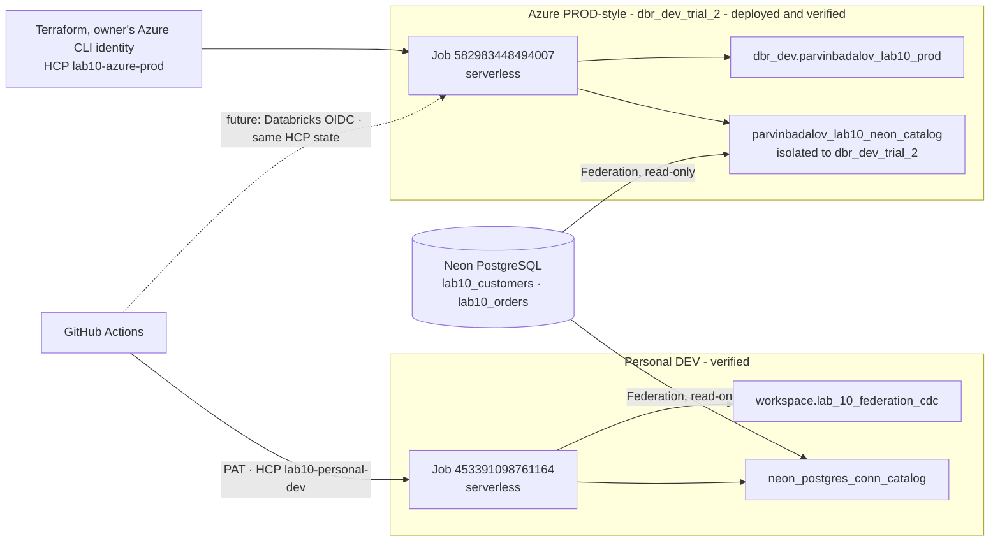

# Lab 10 · Lakehouse Federation & CDC

**Neon PostgreSQL federation · Delta Change Data Feed · checkpointed incremental MERGE · Terraform on HCP · GitHub Actions CI/CD**

> [!IMPORTANT]
> **Personal DEV is complete and verified. Azure PROD is deployed and its end-to-end run passed** (Job `582983448494007` in `dbr_dev_trial_2`, run `499124610685736`: 3/3 tasks SUCCESS, final validation PASS). The Azure Job was deployed with Terraform from the owner's Azure CLI identity; the automated GitHub OIDC deployment path is implemented but waits for an account administrator to create its identity ([ADMIN_REQUEST.md](ADMIN_REQUEST.md)).
>
> "Azure PROD" is a **PROD-style deployment into the Academy workspace `dbr_dev_trial_2`** - a shared training workspace, not a production environment. It is called PROD because it is deployed like one: separate state, a reviewed saved plan, serverless compute, no schedule and no manual Job edits.

**Supervisor review:** start with [SUPERVISOR_REVIEW.md](SUPERVISOR_REVIEW.md).

> [!NOTE]
> **Two integration patterns, deliberately.** Neon PostgreSQL is reached **through Lakehouse Federation** - live, read-only queries. **CDC is simulated on a local Delta table** with **Delta Change Data Feed**. This lab does not capture changes from PostgreSQL itself (no logical replication, WAL decoding or Debezium), so it is not PostgreSQL-native CDC.

## Status at a glance

| Area | Personal DEV | Azure PROD |
|---|---|---|
| Workspace | Personal `dbc-1750318a-76a9.cloud.databricks.com` | Academy **`dbr_dev_trial_2`** `adb-7405618361895520.0.azuredatabricks.net` |
| Unity Catalog | Personal metastore | Shared Academy metastore `metastore_azure_eastus`; data in the shared `dbr_dev` catalog |
| Delta schema | `workspace.lab_10_federation_cdc` | `dbr_dev.parvinbadalov_lab10_prod` ✅ |
| Foreign catalog | `neon_postgres_conn_catalog` | `parvinbadalov_lab10_neon_catalog` ✅ - bound read-only to `dbr_dev_trial_2` only, `ISOLATED` |
| Neon connection | `neon_postgres_conn` | `parvinbadalov_lab10_neon_conn` ✅ (`read_only = true`) |
| Compute | Serverless | Serverless Jobs compute ✅, auto-retry disabled on every task |
| Databricks Job | `453391098761164` ✅ | `582983448494007` `[Azure PROD] Lab 10 Federation & CDC` ✅ |
| Terraform root | [`terraform/`](terraform/) | [`terraform_azure_prod/`](terraform_azure_prod/) |
| HCP Terraform workspace | `lab10-personal-dev` ✅ | `lab10-azure-prod` ✅ (serial 1, one resource) |
| Deployment auth | PAT secret | Done: owner's Azure CLI identity (local apply). Automated: GitHub OIDC → dedicated service principal (*waiting for administrator*) |
| CD workflow | [`lab10_terraform_cd.yml`](../../.github/workflows/lab10_terraform_cd.yml) ✅ | [`lab10_azure_prod_cd.yml`](../../.github/workflows/lab10_azure_prod_cd.yml) (*needs the OIDC identity*) |
| Run workflow | Databricks UI | [`lab10_azure_prod_run.yml`](../../.github/workflows/lab10_azure_prod_run.yml) (*needs the OIDC identity*); the run above used the Jobs API |

## Completion matrix

| Component | Verified status (evidence) | Remaining action |
|---|---|---|
| Personal Federation | 12 customers, 20 orders; hybrid join keeps all 20 orders (re-verified 2026-10-12) | None |
| Personal Delta CDC | Source/target/history 12/12/12; checkpoint 10 = latest; history = CDF versions 3-10 both ways; insert, update and delete events; no-change run `1058102967727375` wrote nothing | None |
| Personal Terraform | HCP state holds only `databricks_job.lab10`; plan `No changes` | None |
| Azure foreign catalog | Created by the owner; bound read-only to `dbr_dev_trial_2`, `ISOLATED`; other workspaces get "not accessible" | None |
| Azure setup | `00_setup` run `326755590926905`: 4 tables, 12 customers seeded from Neon via Federation, checkpoint 0 | None |
| Azure Terraform | Saved plan `1 to add` (only the Job) applied; state serial 1; re-plan `No changes` | After merge, re-point `git_branch` to `main` (in-place update) |
| Azure end-to-end run | Run `499124610685736`: 12 CDF inserts processed, source = target = Neon, history = CDF, checkpoint 0 → 1, final validation PASS | None |
| GitHub CI | Validator, 23 offline tests and both Terraform roots pass on every Lab 10 push | None |
| GitHub OIDC CD | Implemented and statically validated; never run | Account administrator creates the deployer identity ([request](ADMIN_REQUEST.md)) |
| PR #69 | Draft, CI green | Review and merge |

## Architecture



Each Job runs the same notebooks in order:

| Task | Notebook | Writes? |
|---|---|---|
| 1 | [`01_federation_validation`](01_federation_validation.ipynb) - federated counts, hybrid Neon ⨝ Delta join, `EXPLAIN EXTENDED` | No |
| 2 | [`02_incremental_cdc_sync`](02_incremental_cdc_sync.ipynb) - CDF range, target and history `MERGE`, checkpoint | Yes, own schema only |
| 3 | [`03_final_validation`](03_final_validation.ipynb) - reconciliation, uniqueness, audit completeness; returns a JSON summary | No |

[`00_setup`](00_setup.ipynb) is **not** a Job task. It is run once per new environment.

## Lakehouse Federation

A Unity Catalog **connection** stores the Neon endpoint and credentials; a **foreign catalog** exposes the PostgreSQL tables as `<catalog>.public.<table>`. Rows stay in PostgreSQL and Databricks pushes supported work down to it: the Azure plan for `lab10_orders WHERE amount > 100` is a `Scan JDBC` whose `PushedDownOperators` carry the filter. Notebook 01 proves direct federated reads (12 customers, 20 orders) and a hybrid join with a local Delta table.

## Incremental CDC

1. Read `last_processed_version` from `cdc_checkpoint`; read the source's latest version.
2. If they are equal, exit without writing.
3. Otherwise read `table_changes` for exactly the new version range, and refuse duplicate event keys.
4. Keep the newest final-state event per customer and `MERGE` it into `customers_target` (SCD Type 1; deletes remove the row).
5. `MERGE` every event, including update pre-images, into `customer_change_history`, keyed by `(customer_id, _commit_version, _change_type)`.
6. Reconcile target and source **at the processed version** in both directions, and check that every new event is in history.
7. Advance the checkpoint **only after** every check passes.

A failure leaves the checkpoint unchanged, and both writes are `MERGE`s, so the same range can be replayed safely. On serverless, each task sets `disable_auto_optimization = true`, so a failed task is not retried automatically; a failure is inspected first.

## Environment portability

All notebooks take `catalog` and `schema` parameters (01 and 00 also take `foreign_catalog`). The defaults are the Personal DEV names, so the DEV Job - which passes no parameters - behaves exactly as before. The Azure Job passes its own values.

[`00_setup`](00_setup.ipynb) creates the schema and four tables with the same column types as DEV, enables CDF on the source, seeds the source **from Neon through the foreign catalog**, and sets the checkpoint to version 0. The first CDC run then processes the seed as a real batch (12 inserts). It is idempotent: it never drops, truncates, overwrites or reseeds, and it stops on an inconsistent state rather than guessing.

## Why `dbr_dev_trial_2`

Three Academy workspaces share one metastore, so the target workspace decides where the Job runs, not where the shared `dbr_dev` catalog lives.

| | `dbr_dev` | `dbr_dev_trial` | **`dbr_dev_trial_2`** |
|---|---|---|---|
| Azure workspace ID | `7405604503619901` | `7405615123305702` | **`7405618361895520`** |
| My role | user | workspace admin | **workspace admin** |
| Neon connection visible | yes | yes | **yes** |
| Lab 10 foreign catalog | not accessible (isolated) | not accessible (isolated) | **bound read-only** |

`dbr_dev` is the stable workspace, but there I am a plain user rather than a workspace administrator, and the Academy brief selects `dbr_dev_trial_2` for the PROD-style deployment. No `dbr_dev` workspace object is used; only its catalog holds the Delta schema. Both other hosts are explicit deny-list values in the Lab 10 deployment workflows and the static validator. The trial workspace may expire around 2026-10-20; the Delta tables live in the shared `dbr_dev` catalog and survive it, while the Job would need to be redeployed to another workspace by changing the pinned host.

## Terraform and state separation

| | Personal DEV | Azure PROD |
|---|---|---|
| Root | `terraform/` | `terraform_azure_prod/` |
| State | HCP `badalov-lakehouse-labs/lab10-personal-dev` | HCP `badalov-lakehouse-labs/lab10-azure-prod` (local execution) |
| Resource | `databricks_job.lab10` (`453391098761164`) | `databricks_job.lab10_azure_prod` (`582983448494007`) |
| Provider host | pinned to the Personal workspace | pinned to `dbr_dev_trial_2` |
| Provider | `databricks/databricks` 1.137.0 (same lock file) | same |

Separate roots and separate HCP workspaces mean a PROD change can never read, refresh or destroy DEV state, and vice versa. No Azure Storage account is used for Lab 10 state. The Azure Job declares **no** `existing_cluster_id`, `new_cluster` or `job_cluster`, so it runs on serverless Jobs compute.

### Manual Azure deployment (as done on 2026-10-12)

```powershell
cd labs/lab_10_federation_cdc/terraform_azure_prod
$env:DATABRICKS_AUTH_TYPE = "azure-cli"        # az login as the Job owner; no PAT
terraform init
terraform plan  -var git_branch=feature/lab10-azure-prod -out lab10-azure-prod.tfplan
# Review: exactly "1 to add" (first time) or an in-place update, never a destroy.
terraform apply lab10-azure-prod.tfplan
```

After PR #69 is merged, the same plan without `-var git_branch=...` re-points the Job to `main`.

## CI/CD

**CI** ([`lab10_terraform_ci.yml`](../../.github/workflows/lab10_terraform_ci.yml)) compiles every notebook code cell, checks CDC/deployment safety contracts and secret patterns, runs 23 offline tests proving the validator rejects unsafe changes, then runs `fmt -check`, `init -backend=false` and `validate` on **both** Terraform roots. It contacts no workspace.

**Personal DEV CD** - manual; the confirmation field alone decides the operation (empty = plan, `APPLY-453391098761164` = apply).

**Azure PROD CD** ([`lab10_azure_prod_cd.yml`](../../.github/workflows/lab10_azure_prod_cd.yml)) - manual, `main` only. Implemented and validated statically; it cannot run until the deployer identity exists. It uses the **same** HCP state as the manual deployment, so it will update Job `582983448494007`, not create a second one.

| Safeguard | How |
|---|---|
| Plan or apply from one field | empty = plan; `APPLY-LAB10-AZURE-PROD` = apply; anything else fails |
| Approval | apply requires `azure-release-approval`; plan needs none (read-only) |
| Secretless Databricks auth | GitHub environment `lab10-azure` → native `github-oidc` → `github-databricks-academy-deployer` |
| Exact OIDC trust | issuer `https://token.actions.githubusercontent.com`; audience Academy Databricks account ID; subject `repo:BadalovP/Databricks-Academy-Lakehouse:environment:lab10-azure` |
| Correct workspace | the workflow and provider must both name `dbr_dev_trial_2`; the `dbr_dev` and `dbr_dev_trial` hosts are explicitly refused |
| No duplicate Job | a first deployment is refused if a Job with the same name already exists |
| State integrity | state must hold exactly the one Job and match `LAB10_AZURE_PROD_JOB_ID` (`582983448494007`) |
| Safe changes only | one `create` on the first deployment; afterwards only no-op or in-place update |
| Serverless only | any task or Job referencing cluster compute fails the plan |
| Exact plan | apply uses the saved plan; the Job is then re-read and verified |
| Supply-chain control | third-party workflow actions are pinned to immutable commit SHAs |

**Azure PROD run** ([`lab10_azure_prod_run.yml`](../../.github/workflows/lab10_azure_prod_run.yml)) - separate confirmation `RUN-LAB10-AZURE-PROD` and approval; refuses cluster compute, uses an idempotency token, and writes the run ID, per-task results and the final validation JSON to the run summary.

## Verified results

| Check | Personal DEV | Azure PROD |
|---|---|---|
| Federated Neon customers / orders | 12 / 20 | 12 / 20 |
| Hybrid join: orders kept / without a Delta customer | 20 / 3 (after simulated deletes) | 20 / 0 |
| Delta source / target / history | 12 / 12 / 12 | 12 / 12 / 12 |
| Source-target differences (both directions) | 0 / 0 | 0 / 0 |
| History vs CDF (both directions) | 0 / 0 (versions 3-10) | 0 / 0 (version 1) |
| Duplicate keys (target, history) | 0, 0 | 0, 0 |
| Checkpoint = latest source version | 10 | 1 |
| CDF event types processed | insert, update pre/post-image, delete | insert (seed batch) |
| No-change rerun | run `1058102967727375`: 0 events, nothing written | not repeated (would add a run without new information) |
| Job runs | `1058102967727375`, `674533552504139` SUCCESS | `499124610685736` SUCCESS (3/3 tasks, attempt 0) |
| Terraform | plan `No changes` | apply `1 added`; re-plan `No changes` |
| CD | plan run `38102000753`; apply run `38102681544` (0 changes) | not run (OIDC identity pending) |
| CI | green | green (runs `38185218270`, `38186832636`) |

## Evidence

- [2026-10-12 manual Azure deployment and end-to-end run](evidence/2026-10-12-manual-azure-deployment.md) - Azure setup, binding, Terraform apply, the Job run, independent SQL checks, Personal DEV re-verification
- [2026-10-12 manual deployment readiness](evidence/2026-10-12-manual-deployment-readiness.md)
- [2026-10-12 approved setup](evidence/2026-10-12-approved-setup.md) - HCP workspace, GitHub environment, first plan
- [2026-10-12 validation and OIDC review](evidence/2026-10-12-validation-and-oidc-review.md)
- [2026-10-12 read-only audit](evidence/2026-10-12-read-only-audit.md)

## Cost and cleanup

Lab 10 creates no cluster, warehouse, schedule or trigger. Each Job run is a short serverless run (about two minutes). In Azure this task created one schema with four small tables, one Job, one catalog binding and one HCP state version; it ran one setup run and one Job run.

To remove the Azure deployment (only on purpose - it is the reviewed evidence):

1. `terraform destroy` in `terraform_azure_prod/` (deletes only Job `582983448494007`).
2. `DROP SCHEMA dbr_dev.parvinbadalov_lab10_prod CASCADE`.
3. Optionally drop `parvinbadalov_lab10_neon_catalog`. Keep the connection `parvinbadalov_lab10_neon_conn`; it predates this lab's Azure deployment.

Never remove Personal DEV Job `453391098761164` or its HCP state.

## Limitations

- **CDC is simulated** on Delta with CDF; PostgreSQL changes are visible through Federation but not captured as CDC events.
- **Small scale:** 12 customers prove correctness and replay safety, not throughput.
- **Azure proves the insert path only.** Updates, deletes and the no-change run were proven in Personal DEV with the same notebooks; repeating them in Azure would require artificial source changes and more runs.
- **Shared catalog:** `account users` holds `ALL_PRIVILEGES` on `dbr_dev`, so the Lab 10 schema is isolated by naming and convention, not by grants. That is an Academy setting outside this lab's control.
- **Git-backed tasks** read notebooks from GitHub with the run-as user's Git credential (GitHub OAuth linked in `dbr_dev_trial_2`). Until PR #69 is merged, the Azure Job reads branch `feature/lab10-azure-prod`.
- **Trial workspace** `dbr_dev_trial_2` may expire around 2026-10-20.
- **Notebooks are committed without outputs**; results come from Job runs.
