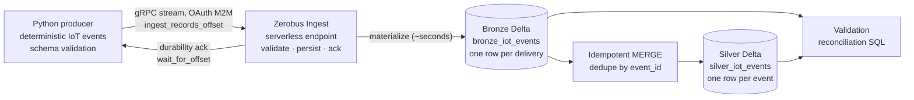
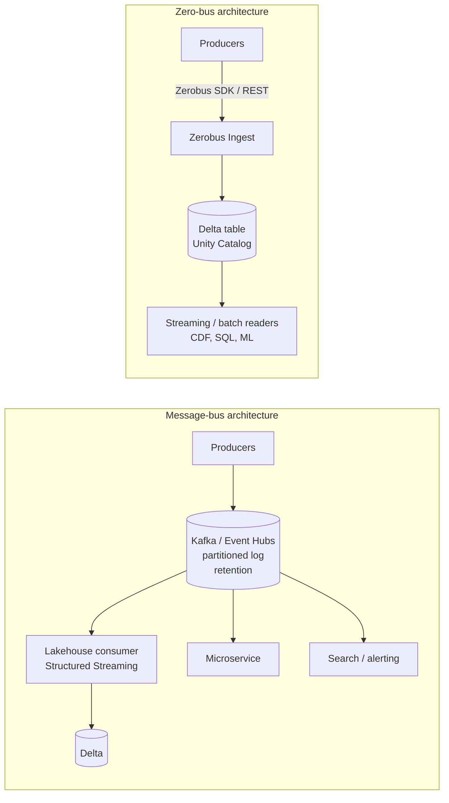

# Lab 11 · Zero-Bus Streaming with Databricks Zerobus Ingest

**IoT telemetry pushed straight into Unity Catalog Delta · durability acknowledgments · at-least-once delivery · idempotent Bronze-to-Silver MERGE · Kafka vs Zerobus trade-offs**

> **Status (2026-10-12): implemented and live-validated in two environments.** Personal DEV (AWS) and Academy Azure `dbr_dev_trial_2` each received one bounded run of 30 real records through the official Zerobus Python SDK into a managed Delta table. In both, all 30 were acknowledged and landed unchanged, the 6 deliberate duplicates were detected, Silver holds the 24 unique events, and a second MERGE changed nothing. Evidence: [`evidence/`](evidence/).

## Overview and scenario

A fleet of temperature and humidity sensors reports readings. Instead of publishing to a message bus and running a consumer that copies messages into the lakehouse, the producer writes **directly** into a Unity Catalog Delta table through **Zerobus Ingest**, the Databricks serverless ingestion endpoint. Downstream, an idempotent `MERGE` turns the at-least-once Bronze stream into one clean row per event.

All devices, readings and identifiers are generated, fictional test data.

| Lab 11 requirement | Where |
|---|---|
| Producer that routes events directly to a UC Delta table through Zerobus | [`src/lab11/ingestion.py`](src/lab11/ingestion.py), [`scripts/run_producer.py`](scripts/run_producer.py); [live run](evidence/2026-10-12-personal-dev-live-validation.md) |
| Idempotent processing | [`sql/01_deduplication.sql`](sql/01_deduplication.sql), [`src/lab11/idempotency.py`](src/lab11/idempotency.py); second live MERGE affected 0 rows |
| Kafka-style vs zero-bus comparison | [Kafka / Event Hubs vs Zerobus](#kafka--event-hubs-vs-zerobus) |
| Event-driven pipelines, decoupling, cost, reliability, operations | same section, plus [Limitations and cost](#limitations-and-cost) |

## Technology stack

| Layer | Technology |
|---|---|
| Producer | Python 3.11, `databricks-zerobus-ingest-sdk` 1.10 (synchronous JSON stream over gRPC) |
| Authentication | Databricks OAuth M2M for a service principal; secret from environment variables |
| Storage | Unity Catalog managed Delta tables (Bronze, Silver) |
| Processing | Databricks SQL `MERGE` on an existing serverless SQL warehouse |
| Verification | Databricks SQL Statement Execution API (`databricks-sdk`) |
| Tests and CI | pytest, a fake SDK, DuckDB running the real SQL, Ruff, GitHub Actions |

## Architecture



The acknowledgment confirms **durability, not queryability**: Zerobus first persists a record, acknowledges it, then commits it to the Delta table as a separate step. In the live run that commit followed the last acknowledgment by about 5 seconds.

## Event schema

The Bronze table is the contract Zerobus enforces; [`events.BRONZE_COLUMNS`](src/lab11/events.py) and [`sql/00_create_tables.sql`](sql/00_create_tables.sql) are kept identical by a test.

| Column | Delta type | Meaning |
|---|---|---|
| `event_id` | STRING | UUIDv5 of `producer_id + run_id + device_id + sequence_number`, stable across retries |
| `device_id` | STRING | `device-01` ... `device-04` |
| `producer_id` | STRING | producer instance |
| `sequence_number` | BIGINT | per-device reading number |
| `event_timestamp` | TIMESTAMP | reading time (sent as epoch microseconds, as Zerobus requires) |
| `temperature`, `humidity` | DOUBLE | validated ranges -50..150 °C and 0..100 % |
| `run_id` | STRING | producer run |
| `batch_id`, `produced_at` | STRING, TIMESTAMP | **delivery metadata** - differ between duplicate deliveries of one event |

Before anything is sent, every record is checked for missing or null fields, unknown fields (Zerobus rejects them by default), wrong types, non-finite numbers, out-of-range values and malformed UUIDs.

## Producer

1. **Generate** a finite, deterministic run: 4 devices × 6 readings = 24 events. The same run ID always gives the same events and IDs.
2. **Plan** deliveries: every event once (`primary`), then 6 of them again with the same `event_id` (`replay`). The replay reproduces the duplicate a producer creates when it retries after a lost acknowledgment. Batches of at most 10; 30 records in total, the configured hard limit.
3. **Send** each batch with `ingest_records_offset`, then block on `wait_for_offset` for its offset. A batch is reported as delivered only after this durability acknowledgment.
4. **Close** the stream (`close` flushes) in a `finally` block.

| Failure | Handling |
|---|---|
| `NonRetriableException` (bad credentials, missing table, schema mismatch) | stop at once with a clear error; no retry |
| Other `ZerobusException` (transient) | close the stream, back off 1 s, 2 s, ... (capped at 8 s), open a new stream, re-send the whole batch; at most 3 attempts |
| Missing credentials | fails before any network call and names the variables and required privileges |

Re-sending a batch can duplicate records the server had already persisted. That is what at-least-once means, and the downstream MERGE absorbs it. The SDK's built-in recovery (on by default) can likewise replay unacknowledged records.

`--dry-run` builds and validates the whole plan and prints it without importing the SDK or touching the network. Logs contain counts, offsets and timings, never credentials; the credential object's `repr` masks the secret.

## Bronze and Silver design

**Bronze** is append-only and written only by Zerobus: one row per delivery, duplicates included. Nothing else writes to it.

**Silver** holds one row per `event_id`, produced by [`01_deduplication.sql`](sql/01_deduplication.sql):

- **Canonical delivery:** the earliest `produced_at`, with ties broken by the smallest `batch_id`. Duplicates carry identical readings, so the rule only decides which delivery metadata Silver keeps, and it is deterministic regardless of arrival order.
- **`delivery_count`:** how many Bronze rows the event has, so duplicates stay visible.
- **Changed rows only:** `WHEN MATCHED AND NOT (all columns IS NOT DISTINCT FROM ...)` means unchanged rows are never rewritten. A late duplicate updates only that event's `delivery_count`.
- **Non-destructive setup:** [`00_create_tables.sql`](sql/00_create_tables.sql) only uses `CREATE ... IF NOT EXISTS`. A test forbids `DROP`, `TRUNCATE`, `DELETE`, `INSERT OVERWRITE` and `CREATE OR REPLACE` in every SQL file.

The MERGE reads all of Bronze, which is right for a lab-sized table. At scale it would read only new Bronze commits (Delta Change Data Feed or a streaming read) - the deduplication rule stays the same.

## Idempotency and retries

Three different things are easy to confuse:

| Layer | Guarantee here | Mechanism |
|---|---|---|
| Producer | **Duplicates are avoided but not impossible** | Stable `event_id`; a batch is resent only after a transient failure |
| Zerobus Ingest | **At-least-once** when the client waits for the acknowledgment and retries what was not acknowledged; ordering only within one stream | Durability acknowledgment; no deduplication |
| Silver | **Idempotent result:** each event once, re-runs change nothing | MERGE keyed by `event_id` with a deterministic tie-break |

Zerobus does not make rows unique, and this project does not claim end-to-end exactly-once delivery. It claims an **exactly-once result in Silver**, built on at-least-once delivery plus idempotent processing. [`02_validation.sql`](sql/02_validation.sql) reconciles each run:
- raw rows, unique events and duplicate deliveries;
- conflicting payloads and null fields;
- Silver rows and duplicate keys;
- set differences between Bronze and Silver in both directions;
- `delivery_count` correctness.

## Kafka / Event Hubs vs Zerobus



| Dimension | Kafka / Event Hubs | Databricks Zerobus Ingest |
|---|---|---|
| Architecture | Broker cluster (Kafka) or managed namespace (Event Hubs) holding a partitioned, replicated log between producers and consumers | Serverless write endpoint in front of Unity Catalog tables; no intermediate log you operate |
| Data ingestion path | Producer → broker → consumer job → Delta (two hops, one extra service to run) | Producer → Zerobus → Delta table (one hop; the service commits to the table) |
| Storage and retention | The log is the store: retention by time or size, compaction (Kafka); Event Hubs tiers retain for a bounded number of days, longer with Capture | The Delta table is the store: governed by UC, kept until you delete it; history via Delta time travel within retention settings |
| Multiple consumers | First-class: independent consumer groups each read the full stream at their own pace | Consumers read the Delta table (SQL, streaming reads, Change Data Feed); there is no topic for non-lakehouse systems to subscribe to |
| Independent replay | Reset a consumer group's offsets and re-read the raw messages without affecting others | Re-read from the table (time travel, CDF) - effective inside the lakehouse, but not a raw message log for outside services |
| Ordering | Per partition | Per stream; none across streams. Use a sequence number or timestamp for total order |
| Delivery guarantees | At-least-once by default; Kafka's idempotent producer and transactions give exactly-once within Kafka and to compatible sinks | At-least-once when acknowledgments are awaited and unacknowledged records retried |
| Idempotency | Can be partly handled by the bus (idempotent producer) plus consumer-side deduplication | Must be handled downstream (here: MERGE by `event_id`) |
| Backpressure and reliability | The broker buffers; slow consumers build lag without blocking producers; replication protects data | Client limits in-flight records; the service persists before acknowledging and keeps unflushed data durable for up to 28 days |
| Operational complexity | Brokers or namespaces, partitions, consumer groups, schema registry, connectors; managed services reduce but do not remove this | No brokers or consumers; you own the table schema contract (never auto-evolved), service principals and producer clients |
| Scaling | Partition count bounds consumer parallelism; repartitioning is disruptive (fixed counts on some Event Hubs tiers) | Serverless; scale out by opening more streams; documented default quotas per stream and table |
| Monitoring | Mature: consumer lag, broker and partition metrics, a large tool ecosystem | Producer-side acknowledgments and callbacks, table history and freshness; fewer moving parts but a younger tool ecosystem |
| Latency | Milliseconds to the broker, plus however often the consumer lands data in Delta | Documented ~150 ms to durability and ~5 s to table; live run: 0.19-0.20 s per warm batch acknowledgment, ~5 s to the Delta commit |
| Cost considerations | Broker or throughput capacity, plus always-on consumer compute, plus storage | Usage-based serverless ingestion, plus Delta storage, plus downstream processing; not measured in this lab |
| Best use cases | Many independent consumers, microservice integration, event sourcing, replayable logs, processing outside Databricks | High-volume telemetry, IoT, clickstream and application events whose destination is the lakehouse |
| Limitations | Operational burden, an extra hop and component, consumer code to land data | One destination (UC tables); managed tables only (no external tables or views); no private-endpoint-secured storage; supported regions only; service-principal OAuth (or a federation policy) |

**When removing the bus is simpler.** If every event ends up in the lakehouse, the bus is only a transit buffer. Dropping it removes a cluster or namespace, a consumer job, its checkpoints and its failure modes. The landing table is governed by Unity Catalog from the first write.

**When Kafka or Event Hubs still wins.** A log decouples producers from *many* consumers that evolve independently, each with its own offset and replay. Services outside Databricks can subscribe without touching the lakehouse. Zerobus does not provide that fan-out, so it does not replace a bus in an event-driven microservice platform. Its Kafka-compatible API (Beta) eases migrating *producers*, not consumers.

**Fewer components is not automatically cheaper.** Total cost depends on volume, message size, retention needs, how many consumers would otherwise run, existing contracts, and the price of serverless ingestion versus capacity you already pay for. Neither latency nor cost claims are meaningful without measuring the real workload. This lab's 30-record run is a functional test, not a benchmark.

**Duplicate delivery vs idempotency.** Duplicate delivery is a property of the transport: retries after a lost acknowledgment resend data. Idempotency is a property of the processing: applying the same input twice gives the same result. A bus or an endpoint can only reduce duplicates. Correctness comes from stable event IDs and a deterministic, re-runnable MERGE.

## Setup and authentication

Zerobus authenticates with **Databricks OAuth M2M credentials of a service principal**; personal access tokens are not accepted. The SDK also supports token federation, which needs an account-level federation policy and was not used here. The service principal needs:
- the `workspace-access` entitlement;
- `USE CATALOG` on the catalog;
- `USE SCHEMA` on the schema;
- `SELECT` and `MODIFY` on the Bronze table only.

```powershell
cd labs/lab_11_zerobus
py -3.11 -m venv .venv
.venv\Scripts\python -m pip install -e ".[zerobus,databricks,dev]"

# The ingesting identity: set in the shell, never in files.
$env:ZEROBUS_CLIENT_ID = "<service principal application ID>"
$env:ZEROBUS_CLIENT_SECRET = "<OAuth secret>"
```

Verification and setup use your **own** identity: the CLI profile or Azure CLI configured per target in [`config/lab11.toml`](config/lab11.toml). Prefer short-lived secrets and delete them after use; the live run here used a one-hour secret that was deleted straight afterwards.

## Commands

```powershell
# Read-only preflight: identity, endpoint DNS, tables, service principal grants, warehouses
.venv\Scripts\python scripts/check_access.py --target personal_dev   # or azure_trial2

# Create the schema and the two tables if missing (never drops anything)
.venv\Scripts\python scripts/setup_tables.py --target personal_dev --confirm personal_dev

# Dry run: validate and print the plan, no network writes
.venv\Scripts\python scripts/run_producer.py --target personal_dev --run-id run-001 --dry-run

# Live: one bounded run (30 records), waits for every acknowledgment, writes a manifest to evidence/
.venv\Scripts\python scripts/run_producer.py --target personal_dev --run-id run-001 --live --confirm-live personal_dev

# Verify: time to table, payloads, MERGE twice, reconciliation, schema contents
.venv\Scripts\python scripts/run_validation.py --target personal_dev --run-id run-001
```

[`notebooks/01_validate_zerobus.py`](notebooks/01_validate_zerobus.py) runs the same MERGE and reconciliation SQL inside a Databricks workspace.

## Offline tests and CI

```powershell
.venv\Scripts\ruff check .
.venv\Scripts\ruff format --check .
.venv\Scripts\python -m pytest
```

78 offline tests, all passing:

| Area | What is proved |
|---|---|
| Configuration | endpoint format for Azure and AWS, 30-record limit, safe identifiers, masked secrets, clear credential errors |
| Events | determinism, stable UUIDv5 IDs, every invalid or missing field rejected before sending |
| Producer | primary and replay deliveries, batch sizes, replayed records keep their identity |
| Transport (**fake SDK**) | acknowledgment awaited per batch, transient retry with backoff and a new stream, permanent errors not retried, retries exhausted, missing offset, credentials never logged |
| Idempotency | unique, duplicate, retried and overlapping batches; deterministic tie-break; re-runs change nothing; conflicts detected |
| SQL (**DuckDB**) | the real `01_deduplication.sql` and `02_validation.sql` give the same results as the Python reference, and a second MERGE affects 0 rows |
| Static and safety | DDL equals the producer contract, no destructive SQL, read-only validation, CI needs no secrets, no credentials in the tree |
| SDK interface | the installed SDK exposes the exact methods and signatures the producer calls |

The fake-SDK and DuckDB tests prove control flow and SQL logic only. **Live behaviour is proven only by the evidence files.**

[`lab11_ci.yml`](../../.github/workflows/lab11_ci.yml) runs Ruff, pytest and a producer dry run on every Lab 11 pull request and push to `main`. It needs no secrets and deploys or sends nothing.

## Validation results

### Personal DEV - PASS

Run `pdev-run-001`, details in [the live validation record](evidence/2026-10-12-personal-dev-live-validation.md):

| Metric | Result |
|---|---|
| Workspace / tables | Personal `dbc-1750318a-76a9` (AWS `us-east-2`); `workspace.lab_11_zerobus.bronze_iot_events`, `...silver_iot_events` |
| Sent / acknowledged / retries | 30 / 30 / 0 (4 batches, each awaited with `wait_for_offset`) |
| Acknowledgment time | 3.25 s for the first batch (includes token and stream setup), 0.19-0.20 s for the next three |
| Landed in Bronze | 30; every row identical to the record sent |
| Time to Delta | Bronze commit about 5 s after the last acknowledgment (Delta history, 1 s resolution) |
| Unique events / duplicate deliveries detected | 24 / 6 |
| Silver after MERGE 1 / MERGE 2 | 24 inserted / 0 affected rows, snapshot identical |
| Reconciliation | 0 conflicts, nulls, missing, unexpected or wrong delivery counts |

### Azure dbr_dev_trial_2 - PASS

Run `t2-run-001`, details in [the Azure live validation record](evidence/2026-10-12-azure-trial2-live-validation.md):

| Metric | Result |
|---|---|
| Workspace / tables | Academy `dbr_dev_trial_2` (Azure `eastus`); `dbr_dev.parvinbadalov_lab11_zerobus_trial2.bronze_iot_events`, `...silver_iot_events` |
| Ingesting identity | Existing Academy service principal `sp-databricks-adls` (Entra-managed, `d1a2118a-...`), reused at the administrator's request; temporary workspace assignment (`USER`, `workspace-access` only) removed after the run |
| Credential | Administrator-issued Databricks OAuth secret read from a Key Vault-backed secret scope into memory only |
| Sent / acknowledged / retries | 30 / 30 / 0 (4 batches, each awaited with `wait_for_offset`) |
| Acknowledgment time | 3.27 s for the first batch (includes token and stream setup), 0.19-0.20 s for the next three |
| Landed in Bronze | 30; every row identical to the record sent |
| Time to Delta | Bronze commit about 3 s after the last acknowledgment (Delta history, 1 s resolution) |
| Unique events / duplicate deliveries detected | 24 / 6 |
| Silver after MERGE 1 / MERGE 2 | 24 inserted / 0 affected rows, snapshot identical |
| Reconciliation | 0 conflicts, nulls, missing, unexpected or wrong delivery counts |

### Environment differences

| | Personal DEV | Azure trial2 |
|---|---|---|
| Cloud and region | AWS `us-east-2` | Azure `eastus` |
| Catalog and schema | `workspace.lab_11_zerobus` | `dbr_dev.parvinbadalov_lab11_zerobus_trial2` (shared Academy metastore) |
| Service principal | `lab11-zerobus-producer`, created for this lab with Bronze-only grants | Shared `sp-databricks-adls`, reused; its existing `dbr_dev` privileges cover the table |
| Secret handling | One-hour secret created and deleted by the owner | Secret issued by the account administrator; revocation is the administrator's step |

The same code, SQL and validation ran unchanged in both environments; only the `--target` differs.

The `azure_dev` target (`dbr_dev` workspace) stays in the configuration but was **not tested**. In `dbr_dev` the owner is not a workspace administrator and has no SQL warehouse permission.

## Limitations and cost

- **Scope:** one 30-record functional run in each of two environments; no throughput, latency distribution or cost measurement.
- **Zerobus constraints:** service-principal OAuth (or an account federation policy); managed Delta or streaming tables only; table schema never auto-evolves; ordering only within one stream; the target table must not be renamed or replaced while streams write to it.
- **Silver** reprocesses all of Bronze each time; at scale, process only new commits.
- **Cost:** the live run used Zerobus serverless ingestion for 30 records and a few statements on an existing serverless SQL warehouse. No cluster, warehouse, Job or schedule was created. Remaining objects:
  - in Personal DEV, the two small tables and the service principal `lab11-zerobus-producer`, which has no secret left;
  - in Azure, the two small tables in `dbr_dev.parvinbadalov_lab11_zerobus_trial2`. The shared service principal is no longer assigned to the workspace. The administrator-issued OAuth secret is still to be revoked by the administrator.

## Repository structure

```text
lab_11_zerobus/
|-- config/lab11.toml            # producer, retry policy, targets (no credentials)
|-- src/lab11/
|   |-- config.py                # typed settings, endpoint derivation, env credentials
|   |-- events.py                # schema contract, deterministic events, validation
|   |-- producer.py              # delivery plan: primary + controlled replay batches
|   |-- ingestion.py             # Zerobus SDK transport: acks, retries, close
|   |-- idempotency.py           # Python reference of the dedup/MERGE policy
|   `-- verification.py          # SQL rendering, reconciliation, Statement Execution runner
|-- sql/                         # create tables, idempotent MERGE, reconciliation
|-- scripts/                     # check_access, setup_tables, run_producer, run_validation
|-- notebooks/01_validate_zerobus.py
|-- tests/                       # 78 offline tests (fake SDK, DuckDB, static checks)
`-- evidence/                    # sanitized live-run manifests and validation results
```
