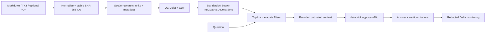

# Lab 12 - AI Capstone: Governed IT Operations RAG

An offline-testable, deployment-ready knowledge assistant over six original fictional IT operations runbooks. The project demonstrates deterministic ingestion and chunking, Unity Catalog Delta design, Databricks AI Search Delta Sync, grounded generation, evaluation, monitoring, and an independent Declarative Automation Bundle.

> **Status (2026-10-11): complete in Personal DEV and deployed to Azure PROD.** Merged to `main` via [PR #70](https://github.com/BadalovP/Databricks-Academy-Lakehouse/pull/70) (commit `92fc130`, CI green). Personal DEV: full 18-question live evaluation (RAG 0.843 vs 0.181 without retrieval; manual review 14/3/1), one repeat sync, and live re-runs after the quality fixes - all four originally imperfect answers (q01, q09, q12, q13) now correct. Azure PROD (`dbr_dev_trial_2`): Job `477888651684662`, 6 documents / 30 chunks, Standard endpoint and TRIGGERED index ready at 30/30, one grounded smoke answer. Evidence for every stage is in [`evidence/`](evidence/); the runbook is [Deployment](docs/DEPLOYMENT.md).

## What it answers

The corpus covers batch recovery, incident escalation, SQL performance, data pipeline failures, monitoring, and change validation. Example questions:

- “How should an Aurora streaming replay be performed safely?” Expected: isolated checkpoint, dedicated recovery table, reconciliation, and citations.
- “When may an Atlas warehouse be resized?” Expected: query-profile evidence plus cost-owner approval.
- “What is the production DBA's phone number?” Expected: the documents do not contain enough information.

All organizations, services, roles, thresholds, and procedures in `data/sample_docs/` are fictional training material.

## Architecture



The managed index uses `databricks-gte-large-en`. Its source is `<catalog>.<schema>.document_chunks` for the selected target (`parvinbadalov_lab12_rag_dev` or `_prod`), with Change Data Feed enabled. Retrieval uses HYBRID search (vectors + keywords). The implementation follows the current [AI Search Delta Sync SDK shape](https://docs.databricks.com/aws/en/ai-search/create-ai-search) and uses Databricks' documented [Foundation Model chat interface](https://docs.databricks.com/gcp/en/machine-learning/model-serving/query-chat-models).

Read [Architecture](docs/ARCHITECTURE.md) for trust boundaries and design rationale.

## Repository map

```text
lab_12_ai_capstone_rag/
|-- config/                 # environment and 18 evaluation cases
|-- data/sample_docs/       # six fictional runbooks
|-- src/lab12/              # modular ingestion-to-monitoring package
|-- notebooks/              # gated Databricks workflows
|-- resources/              # one manual-only serverless Job
|-- scripts/                # offline validation/demo and read-only access inventory
|-- tests/                  # deterministic unit tests; no workspace needed
|-- docs/                   # architecture, deployment, evaluation, monitoring, AI tools
|-- evidence/               # real sanitized evidence added only after live approval
|-- databricks.yml          # standalone bundle
`-- pyproject.toml
```

## Run entirely offline

Python 3.11 or newer is required.

```powershell
Set-Location labs\lab_12_ai_capstone_rag
python -m venv .venv
.\.venv\Scripts\Activate.ps1
python -m pip install -e ".[dev]"
ruff check .
pytest
python scripts\validate_bundle_static.py
lab12 ask "How should an Aurora streaming replay be performed safely?"
lab12 evaluate
```

The offline retriever is deterministic token overlap and the offline answerer is extractive. They validate application behavior without pretending to be a substitute for semantic search or an LLM.

### Validation results (2026-10-11)

| Check | Result |
|---|---|
| Ruff | PASS |
| Pytest | PASS - **195 tests** (35 from Phase 1 + 160 for later fixes) |
| Offline bundle safety validator | PASS - two pinned targets, no default, serverless-only, live flags off |
| `bundle validate --strict -t personal_dev` | PASS (Personal workspace, read-only) |
| `bundle validate --strict -t azure_prod` | PASS (`dbr_dev_trial_2`, read-only) |
| `bundle plan` for each target | `1 to add, 0 to change, 0 to delete` - the Job only |
| Unqualified `bundle validate` | refused: `please specify target` |
| Personal profile against `azure_prod` | refused: profile host doesn't match bundle host |
| Offline fixture: retrieval recall / correctness | 1.0 (15 applicable) / 0.611 across 18 cases (fixture, not semantic quality) |
| Personal DEV deploy + dry run (all flags `false`) | SUCCESS - run `339422254987549`, 107 s, 6 documents / 30 chunks, nothing written |
| Personal DEV ingestion + rerun | SUCCESS - runs `364638550422539` (inserted 6 / 30) and `680000904141062` (0 / 0 / 0, fingerprints unchanged) |

These prove structure, safety gates and adapter logic. **They do not prove live RAG quality**:
retrieval, embeddings and generation are only exercised by an approved Personal DEV run.

## Two environments

| | Personal DEV (`personal_dev`) | Azure PROD (`azure_prod`) |
|---|---|---|
| Workspace | `dbc-1750318a-76a9.cloud.databricks.com` | `adb-7405618361895520.0.azuredatabricks.net` (Academy `dbr_dev_trial_2`, trial SKU, ends about 2026-10-20) |
| Auth | CLI profile `personal_lab10` | Azure CLI (`DATABRICKS_AUTH_TYPE=azure-cli`) |
| Bundle mode | development | production |
| Job | `463111948320208` | `477888651684662` |
| Schema | `dbr_dev.parvinbadalov_lab12_rag_dev` | `dbr_dev.parvinbadalov_lab12_rag_prod` |
| AI Search endpoint | `lab12-rag-dev` (STANDARD, ONLINE) | `parvinbadalov-lab12-rag-prod` (STANDARD, ONLINE) |
| Index | `...rag_dev.document_chunks_index`, 30 rows, 2 sync updates | `...rag_prod.document_chunks_index`, 30 rows, 1 sync update |
| Live answers | 18-question evaluation + targeted re-runs | 1 smoke answer (q01) |
| Models | `databricks-gte-large-en`, `databricks-gpt-oss-20b` | same |

Same source (`92fc130`), separate schema, endpoint, index and deployment state.

## Databricks configuration

Per-target values live in `databricks.yml`; `config/default.yml` holds only tunables (chunking,
retrieval, generation) and local defaults. AI Search is a Standard endpoint with `TRIGGERED` sync.
The Job is manual-only: ingest → provision/sync AI Search → evaluate.

Credentials use Databricks unified authentication and are never stored in this project. Read-only
access inventory and validation:

```powershell
python -m pip install -e ".[databricks,dev]"
python scripts\check_access.py --target personal_dev --profile personal_lab10
python scripts\check_access.py --target azure_prod          # uses Azure CLI auth
databricks bundle validate --strict -t personal_dev --profile personal_lab10
```

The access script is read-only and refuses a profile whose host differs from the target.

## Safety controls

- `create_lab_tables`, Delta MERGE, AI Search creation, sync, and live notebook inference all require explicit opt-in.
- The bundle parameters `allow_table_writes`, `allow_ai_search_mutation`, and `run_live_inference` default to `false`.
- The bundle contains no schedule or trigger. Deployment creates a Job but does not run it.
- Pull requests, pushes, and manual CI dispatch run only lint, tests, static YAML checks, and a wheel build. CI has no Databricks credentials and performs no network inference or infrastructure action.
- DDL is scoped to Lab 12 and uses only `CREATE ... IF NOT EXISTS`; it contains no drop or replace operation.
- The prompt treats retrieved text as untrusted, caps context, requires citations, and uses a defined insufficient-information response.
- Monitoring stores a question hash and operational metadata, never raw question, context, answer, token, or provider exception details.

## Acceptance status

| Capability | Status |
|---|---|
| Fictional corpus, ingestion, stable IDs, deduplication | Implemented, tested offline |
| Section-aware chunking with overlap | Implemented, tested offline |
| Delta tables, idempotent snapshot MERGE with pruning, CDF | **Executed in Personal DEV**: 6 / 30 rows, CDF on, zero-change rerun proven by MERGE and Delta metrics |
| AI Search Standard endpoint + TRIGGERED Delta Sync, managed embeddings, sync + readiness wait | **Personal DEV and Azure PROD**: endpoints ONLINE, indexes ready at 30/30; one repeat sync validated in Personal DEV |
| HYBRID top-k retrieval, filters, citations, zero results | Live (18 questions): expected document retrieved 15/15, ranked 1st 13/15; citation precision 0.929, no invalid citations |
| Grounded generation (`databricks-openai` 0.17.1), reasoning-model output handling, safe errors | Live: 18/18 RAG calls `stop`, no errors; baseline empty/truncated/429 responses recorded as errors, not refusals |
| 18-case evaluation: live no-retrieval baseline vs RAG, persisted results | **Executed**: 36 `evaluation_results` rows; per-question manual review in evidence |
| Redacted monitoring persisted to Delta | **Executed**: 18 `query_monitoring` rows with diagnostics, no question/answer text |
| Standalone bundle, two isolated targets, manual serverless Job | **Deployed to both** from the same merged source; offline CI green on the PR and on `main` |
| AI Dev Kit used with an AI coding agent | **Done**: skills installed project-scoped and invoked natively by Claude Code (`databricks-core`, `databricks-vector-search`) for the Stage 5B sync - see [AI Dev Kit](docs/AI_DEV_KIT.md) |
| Live semantic quality, costs, Azure AI Search endpoint permission | Quality: manual review in evidence; Azure endpoint creation permitted (verified by creating it); billing tables lag, so costs are estimates |

## Documentation

- [Architecture](docs/ARCHITECTURE.md)
- [Deployment and cost approval](docs/DEPLOYMENT.md)
- [Evaluation methodology](docs/EVALUATION.md)
- [Monitoring and retention](docs/MONITORING.md)
- [AI Dev Kit and Codex on Windows](docs/AI_DEV_KIT.md)

The next safe milestone is to configure a CLI profile for the exact target host, run the read-only inventory and strict bundle validation, and review the output. Only then should a human decide whether to reuse or create an AI Search endpoint and authorize the first table-writing run.
