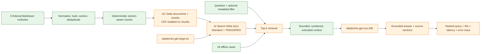

# Architecture

## System boundary

Lab 12 is a standalone Declarative Automation Bundle. It does not include the repository root bundle and does not depend on Lab 8-10 deployment identities or resources.

Green components are verified offline. Orange components have production implementations but require an approved Databricks deployment or live request.

## Key design choices

- Content SHA-256 hashes produce stable document IDs; chunk identity also includes its document, section reference, ordinal, and content hash.
- Markdown headings form section boundaries. Oversized sections are split near paragraphs or sentences with a configurable overlap.
- Delta writes use `MERGE` keyed by stable IDs. DDL uses only `CREATE ... IF NOT EXISTS`; no code drops or replaces objects.
- The chunk table enables Change Data Feed because Standard AI Search Delta Sync requires it.
- AI Search uses a managed embedding source column, `TRIGGERED` synchronization, and an existing-or-approved Standard endpoint.
- Retrieval is an interface. `OfflineLexicalRetriever` makes the complete corpus usable without a workspace; `DatabricksAISearchRetriever` performs real semantic retrieval.
- The prompt says retrieved documents are untrusted data, bounds context size, requires citations, and defines an exact insufficient-information response.
- Monitoring stores no raw prompt, context, or response.

## Trust boundaries

The local corpus is fictional but is still treated as untrusted at generation time. Authentication is delegated to Databricks unified authentication. No token or secret belongs in YAML, notebooks, logs, GitHub variables created for another lab, or evidence files.

